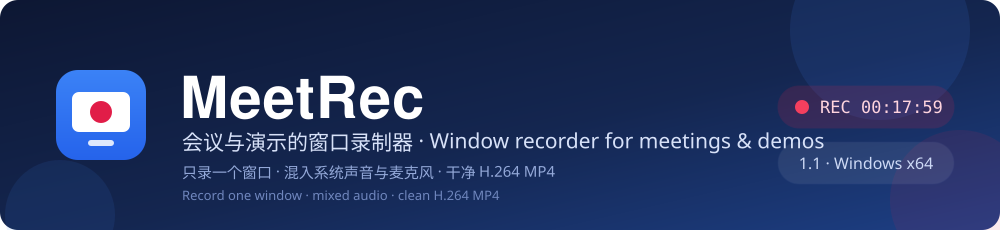
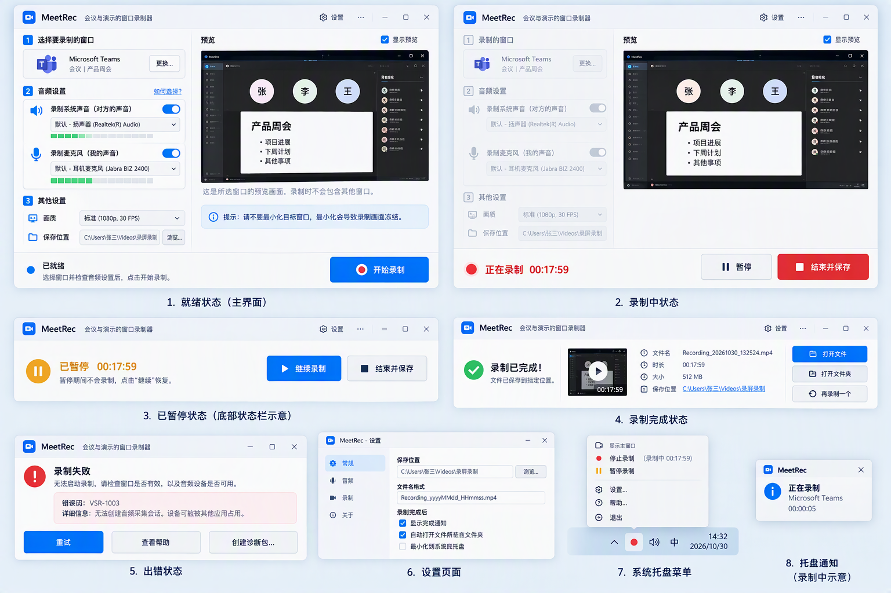
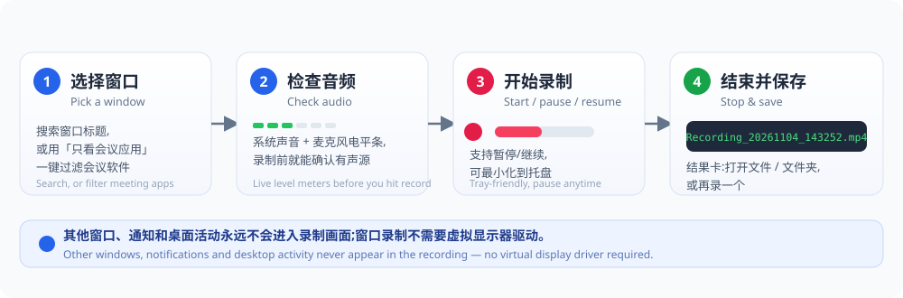
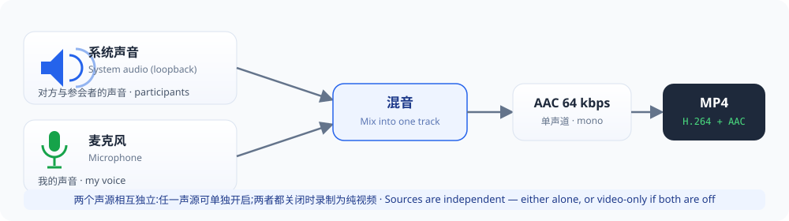
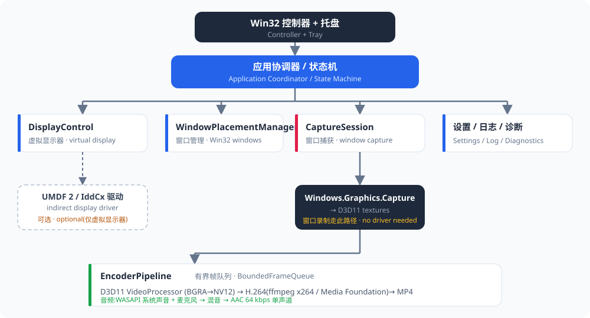

<div align="center">



[](https://github.com/ituff/meetrec/actions/workflows/build-release.yml)


[English](#english) · [简体中文](#简体中文) · [📖 使用手册 Wiki / User Manual](https://github.com/ituff/meetrec/wiki)

</div>

---

# English

**MeetRec (Virtual Screen Recorder)** is a lightweight Windows 10/11 **window recorder for
meetings and demos**: pick **one** application window, optionally mix in system audio (the
other participants) and your microphone, and save a clean **H.264 MP4**. Other windows,
notifications, and desktop activity never appear in the recording — and window recording
needs no virtual display driver and no admin rights.

The product UI is a custom-drawn native Win32 + GDI+ interface (see
[`docs/design/`](docs/design/)). The executable is `MeetRec.exe`; the settings/log directory
keeps the legacy `VirtualScreenRecorder` name so existing users retain their configuration.

| | |
|---|---|
| OS | Windows 10 2004+ x64 (build 19041+) or Windows 11 x64 |
| GPU | Direct3D 11 capable GPU with current vendor driver |
| Rights | No admin rights, no installer (portable), no driver needed |
| Output | H.264 + AAC in MP4 (SDR, 8-bit), per-preset quality |

Not supported: Remote Desktop, Windows Sandbox, GPU-less servers, 32-bit x86, ARM64,
HDR/H.265/AV1/4K. See [docs/known-limitations.md](docs/known-limitations.md).

<p align="center">
  <br>
  <sub>The product UI in its eight states: ready → recording → paused → finished, plus error,
  settings, tray menu and the recording toast.</sub>
</p>

## How it works

<p align="center">
  
</p>

## Features

- **Window-only capture** via Windows.Graphics.Capture — the target is recorded in place;
  nothing else leaks into the frame.
- **Independent audio sources**: WASAPI loopback (system/participants) and microphone, either
  or both, mixed into one AAC track; video-only when both are off.
- **Live level meters** start as soon as a window is selected, so both sources can be verified
  *before* recording; meters stay live while capturing.
- **Full state machine**: Ready, Preparing, Recording, Paused, Saving, a result card
  (file name/duration/size/path with Open file / Open folder / Record again) and an actionable
  error card with Retry / Help / Diagnostics.
- **Window picker** with search, app icons and a **Meeting apps only** filter (Teams, Zoom,
  Tencent Meeting/Wemeet, VooV, DingTalk, Feishu/Lark, WeCom, Webex, Skype, GoToMeeting,
  BlueJeans, Huawei Cloud Meeting, Google Meet in a browser).
- **Settings** (General / Audio / Recording / About), owner-drawn tray menu, and a
  non-activating recording toast. Draggable splitter between settings and preview
  (double-click restores the 40/60 default; ratio persists in `settings.json`).
- **i18n**: Simplified Chinese primary, English included; language follows the Windows display
  language by default and can be overridden in **Settings → General → Language**
  (`system` / `zh-CN` / `en-US`). Stable `VSR-*` error codes gain localized
  titles/explanations.
- **Keyboard accessible**: Tab/Shift+Tab, Enter/Space, arrow keys on dropdowns, Esc; menus use
  native `TrackPopupMenu` semantics.

## Download and run

1. Grab `MeetRec-<version>-win64-with-ffmpeg.zip` from
   [Releases](https://github.com/ituff/meetrec/releases/latest).
2. Extract the **whole** folder to a writable directory (e.g. `D:\Apps\MeetRec`) — `ffmpeg.exe`
   and its DLLs must stay next to `MeetRec.exe`.
3. Double-click `MeetRec.exe`. On the first launch Windows SmartScreen may warn about an
   unsigned publisher — choose *More info → Run anyway*.
4. No admin rights, no VC++ runtime, no driver required (C++ runtime is statically linked and
   ffmpeg is bundled).

A step-by-step illustrated manual is published on the
**[Wiki](https://github.com/ituff/meetrec/wiki)**
([中文](https://github.com/ituff/meetrec/wiki/Manual-zh) /
[English](https://github.com/ituff/meetrec/wiki/Manual-en)); offline copies live in
[`docs/user-manual.zh.md`](docs/user-manual.zh.md) /
[`docs/user-manual.en.md`](docs/user-manual.en.md).

## Record a meeting (recommended)

<p align="center">
  
</p>

- Use the **Standard** preset (1920×1080 @ 30 FPS — 60 FPS buys nothing for slides or talking
  heads). The x264 path uses capped-CRF rate control with a 5-second keyframe interval and
  mono 64 kbps AAC, so static slides spend few bits and text stays sharp — file sizes land in
  the same range as Teams cloud recordings instead of 3–4× larger.
- Enable **both** System audio and Microphone; select the **same devices the meeting app uses**
  (Teams/Zoom/Tencent Meeting keep their own device selection, which can differ from the
  Windows default — recording the wrong endpoint leaves that source silent).
- **Wear headphones**: without them the microphone also picks up the speakers and the recording
  contains an echo of the participants.
- **Do not minimize** the target window while recording — Windows may stop redrawing it and the
  video freezes (the UI shows this hint).
- If your voice is quieter than the participants, set `VSR_MIC_GAIN` (0.25–8.0, default 1.0).

## Build from source

Prerequisites: **Visual Studio 2022** (or Build Tools) with the *Desktop development with C++*
workload — tested with MSVC 14.44 (v143) and Windows SDK **10.0.26100.0**. C++/WinRT headers
ship with the SDK. The optional UMDF driver additionally needs the matching
[WDK](https://learn.microsoft.com/windows-hardware/drivers/download-the-wdk).

```powershell
# Application + tests (works without the WDK)
powershell -File scripts\build.ps1 -Configuration Debug -SkipDriver

# Full build including the UMDF virtual display driver (requires WDK)
powershell -File scripts\build.ps1 -Configuration Debug

# Run the unit tests / clean
powershell -File scripts\test.ps1
powershell -File scripts\clean.ps1
```

Outputs follow the artifact convention (design.md §7.3):

```text
artifacts/<Configuration>/
  app/MeetRec.exe                     # controller application
  driver/VirtualDisplayDriver.*       # UMDF driver package (WDK builds only)
  tests/UnitTests.exe                 # unit test runner
  tests/MediaValidator.exe            # test-only MP4 validation tool
  obj/…                               # static libraries and intermediates
  build-manifest.json                 # tool versions + commit id
```

## Automated builds

`.github/workflows/build-release.yml` builds the Windows x64 Release package on a
`windows-2022` runner: `src/App/App.rc` provides the version (a `v*` tag must match it),
Release build with `-SkipDriver` plus the full Release unit suite, pinned BtbN FFmpeg n9.0
download verified against `checksums.sha256`, packaging into
`MeetRec-<version>-win64-with-ffmpeg.zip`, a bundled-ffmpeg/libx264 smoke encode, and on a
`v*` tag push a GitHub Release with the zip and `SHA256SUMS.txt`. PRs and manual dispatches
build/test/package without publishing. The hosted runner has no D3D11 video processor, so CI
verifies compilation, tests, packaging and ffmpeg — hardware recording is covered by local
runs.

## Architecture

<p align="center">
  
</p>

All first-party modules are static libraries linked into `MeetRec.exe` (NFR-033); the optional
UMDF 2 / IddCx virtual display driver (derived from Microsoft's
[IndirectDisplay sample](https://github.com/microsoft/Windows-driver-samples/tree/main/video/IndirectDisplay),
MIT) remains a separate binary (NFR-034). Driver staging scripts:
`scripts/testsign.ps1`, `scripts/install-driver.ps1`, `scripts/remove-driver.ps1` — the
test-signed driver requires Windows Test Mode on dedicated dev machines only
(see [docs/sample-audit-idd.md](docs/sample-audit-idd.md)).

## Developer CLI

```text
MeetRec.exe                              # controller UI (also creates the tray icon)
MeetRec.exe --dev-record ...             # headless virtual-display recording
MeetRec.exe --dev-record-window ...      # headless window recording
MeetRec.exe --self-check                 # read-only capability report (support tool)
MeetRec.exe --encode-test ...            # full encode-pipeline validation without a driver
```

| Flag | Meaning |
|---|---|
| `--seconds N` | Fixed recording duration |
| `--preset low\|standard\|high` | Quality preset |
| `--output DIR` | Output directory |
| `--encoder auto\|hardware\|software` | Encoder candidate filtering (Media Foundation backend) |
| `--backend ffmpeg\|mf\|auto` | Recording backend; `auto` prefers ffmpeg, falls back to MF |
| `--audio` | Add system audio (loopback) + microphone, mixed into one AAC track |
| `--audio-out/-in <endpoint-id>` | Pin the recorded render/capture endpoints |

Exit codes for `--dev-record`: `0` success · `2` driver/display missing · `3` start rejected ·
`4` never reached Recording · `5` stopped with error.

The default (`--backend auto`) encodes through an **ffmpeg.exe child process** when ffmpeg is
available (`VSR_FFMPEG_PATH`, the application directory, `PATH`, or `C:\ffmpeg\bin`) and
through the Media Foundation sink writer otherwise — bypassing the OS media stack whose
encoder MFTs are unreliable on some Insider builds. Support-only audio dumps:
`VSR_AUDIO_DUMP_LOOPBACK`, `VSR_AUDIO_DUMP_MIC`, `VSR_AUDIO_DUMP`; `VSR_MIC_DISABLE=1` forces
a system-only run.

Data locations (per user): `%LOCALAPPDATA%\VirtualScreenRecorder\` (`settings.json`,
`Logs\`, `Diagnostics\`).

## Testing

- **Unit tests** (`tests/UnitTests`, 64 tests): state machine transitions, pause-aware
  timestamp math, bounded-queue policy, settings/JSON round trips, output naming, disk guards,
  encoder selection, error-code strings, identity matching, log redaction.
- **Media validation** (`tests/IntegrationTests/MediaValidator`): Source Reader based MP4
  validator (container, H.264 stream, dimensions, fps, timestamps, full decode, duration).
- **Integration**: `tests/IntegrationTests/IntegrationTests.ps1` (end-to-end on a machine with
  the driver installed).
- **Manual**: [docs/manual-test-checklist.md](docs/manual-test-checklist.md); traceability in
  [docs/requirements-traceability-matrix.md](docs/requirements-traceability-matrix.md).

## Documentation map

```text
docs/
  adr/                       # architecture decision records (ADR-001..ADR-006)
  design/                    # product UI design brief, annotated mockups
  release/                   # release notes + portable package README
  known-limitations.md       # user-facing limitations and unsupported scenarios
  manual-test-checklist.md   # release qualification checklist
  requirements-traceability-matrix.md
  user-manual.zh.md / user-manual.en.md   # user manuals (Wiki copies)
specs/001-mvp/               # spec, requirements, design, tasks (VSR-MVP-001 v1.0)
installer/MeetRecSetup.iss   # Inno Setup project (internal MVP)
scripts/                     # build / test / clean / driver staging
```

Project status: P0 MVP complete; P1 items implemented beyond baseline are listed in
[docs/task-completion-notes.md](docs/task-completion-notes.md).

## License / attribution

Driver code in `src/Driver` is derived from Microsoft's
[Windows-driver-samples IndirectDisplay](https://github.com/microsoft/Windows-driver-samples)
sample (MIT License, Copyright (c) Microsoft Corporation); the bundled FFmpeg is GPLv3 with
license text staged next to the executable. All other first-party code is part of the Virtual
Screen Recorder project. See [docs/sample-audit-idd.md](docs/sample-audit-idd.md).

---

# 简体中文

**MeetRec(Virtual Screen Recorder)** 是一款轻量的 Windows 10/11 **会议/演示窗口录制器**:
只选**一个**应用窗口,可同时混入系统声音(对方/参会者)和麦克风(我的声音),输出干净的
**H.264 MP4**。其他窗口、通知和桌面活动永远不会出现在录制画面中——窗口录制不需要虚拟
显示器驱动,也不需要管理员权限。

产品界面为自绘的原生 Win32 + GDI+ 界面(见 [`docs/design/`](docs/design/))。可执行文件为
`MeetRec.exe`;设置/日志目录沿用旧名 `VirtualScreenRecorder`,老用户的配置不受影响。

| | |
|---|---|
| 操作系统 | Windows 10 2004+ x64(build 19041+)或 Windows 11 x64 |
| GPU | 支持 Direct3D 11 的显卡及厂商驱动 |
| 权限 | 无需管理员、免安装(便携)、无需驱动 |
| 输出 | H.264 + AAC 的 MP4(SDR,8-bit),按画质预设 |

不支持:远程桌面、Windows 沙盒、无 GPU 服务器、32 位 x86、ARM64、HDR/H.265/AV1/4K。
详见 [docs/known-limitations.md](docs/known-limitations.md)。

<p align="center">
  <br>
  <sub>产品界面八种状态:就绪 → 录制中 → 已暂停 → 录制完成,以及出错、设置、托盘菜单与录制通知。</sub>
</p>

## 工作流程

<p align="center">
  
</p>

## 功能特性

- **只录一个窗口**:基于 Windows.Graphics.Capture,原位录制目标窗口,其他内容不会入镜。
- **音频声源相互独立**:WASAPI loopback(系统/对方)与麦克风,可任选或同时开启,混入一条
  AAC 音轨;两者都关闭时录制为纯视频。
- **实时电平条**:选中窗口后立即显示系统声音与麦克风电平(共享模式检测),录制前即可确认
  声源;录制中电平条持续更新。
- **完整状态覆盖**:就绪、准备中、录制中、已暂停、正在保存、结果卡(文件名/时长/大小/路径,
  打开文件 / 打开文件夹 / 再录一个)以及可操作的错误卡(重试 / 查看帮助 / 创建诊断包)。
- **窗口选择器**:支持搜索、应用图标,以及**「只看会议应用」筛选**(Teams、Zoom、腾讯会议、
  VooV、钉钉、飞书、企业微信、Webex、Skype、GoToMeeting、BlueJeans、华为云会议、浏览器
  Google Meet)。
- **设置窗口**(常规 / 音频 / 录制 / 关于)、自绘托盘菜单(打开 / 暂停-继续 / 停止 / 设置 /
  帮助 / 退出)、非激活的录制通知卡片;设置列与预览之间可拖动分割条(双击恢复默认 40/60,
  比例保存在 `settings.json`)。
- **中英文界面**:简体中文为主语言,内置英文;默认跟随 Windows 显示语言,可在
  **设置 → 常规 → 语言** 覆盖(`system` / `zh-CN` / `en-US`)。错误码保留稳定的 `VSR-*`
  标识,并提供本地化的标题与说明。
- **键盘可达**:Tab/Shift+Tab 移动焦点,Enter/Space 激活,方向键操作下拉框,Esc 关闭;
  菜单使用原生 `TrackPopupMenu` 语义。

## 下载与运行

1. 从 [Releases](https://github.com/ituff/meetrec/releases/latest) 下载
   `MeetRec-<版本>-win64-with-ffmpeg.zip`。
2. 将**整个**压缩包解压到可写目录(例如 `D:\Apps\MeetRec`)——`ffmpeg.exe` 及其 DLL 必须
   与 `MeetRec.exe` 在同一目录。
3. 双击 `MeetRec.exe`。首次运行 Windows SmartScreen 可能提示"未知发布者",选择
   *更多信息 → 仍要运行*。
4. 无需管理员、无需 VC++ 运行库(已静态链接)、无需驱动(已内置 ffmpeg)。

图文并茂的分步使用手册发布在 **[Wiki](https://github.com/ituff/meetrec/wiki)**
([中文](https://github.com/ituff/meetrec/wiki/Manual-zh) /
[English](https://github.com/ituff/meetrec/wiki/Manual-en));离线副本见
[`docs/user-manual.zh.md`](docs/user-manual.zh.md) /
[`docs/user-manual.en.md`](docs/user-manual.en.md)。

## 录制会议(推荐设置)

<p align="center">
  
</p>

- 使用**标准**画质(1920×1080 @ 30 FPS——幻灯片和人像 60 FPS 没有收益)。x264 采用
  capped-CRF 恒定质量码控(预设码率只作上限)、5 秒关键帧间隔、单声道 64 kbps AAC:
  静态幻灯片几乎不耗码率、文字保持锐利,文件大小与 Teams 云录制同一量级,而不是早期
  码率目标设置的 3–4 倍。
- 同时开启**系统声音**与**麦克风**;在两个设备选择器中选择**会议软件正在使用的设备**
  (Teams/Zoom/腾讯会议有自己的设备选择,可能与 Windows 默认不同——录错端点会导致该声源
  无声)。
- **戴耳机**:外放会让麦克风同时录到对方声音,录制里出现参会者回声。
- 录制期间**不要最小化**目标窗口——Windows 可能停止重绘导致画面冻结(界面内有提示)。
- 如果自己的声音比参会者轻,可设置 `VSR_MIC_GAIN`(0.25–8.0,默认 1.0)。

## 从源码构建

前置条件:**Visual Studio 2022**(或 Build Tools)勾选 *Desktop development with C++*——
已测工具链 MSVC 14.44(v143)+ Windows SDK **10.0.26100.0**;C++/WinRT 头文件随 SDK 提供。
可选的 UMDF 驱动还需匹配的
[WDK](https://learn.microsoft.com/windows-hardware/drivers/download-the-wdk)。

```powershell
# 应用 + 测试(无需 WDK)
powershell -File scripts\build.ps1 -Configuration Debug -SkipDriver

# 完整构建(含 UMDF 虚拟显示器驱动,需 WDK)
powershell -File scripts\build.ps1 -Configuration Debug

# 运行单元测试 / 清理
powershell -File scripts\test.ps1
powershell -File scripts\clean.ps1
```

产物遵循 artifact 约定(design.md §7.3):

```text
artifacts/<Configuration>/
  app/MeetRec.exe                     # 控制器应用
  driver/VirtualDisplayDriver.*       # UMDF 驱动包(仅 WDK 构建)
  tests/UnitTests.exe                 # 单元测试运行器
  tests/MediaValidator.exe            # 测试专用 MP4 校验工具
  obj/…                               # 静态库与中间产物
  build-manifest.json                 # 工具版本 + 提交 ID
```

## 自动构建

`.github/workflows/build-release.yml` 在 `windows-2022` runner 上构建 Windows x64 Release
包:版本号取自 `src/App/App.rc`(`v*` 标签必须匹配),以 `-SkipDriver` 做 Release 构建 +
完整 Release 单元测试,下载固定的 BtbN FFmpeg n9.0 并校验 `checksums.sha256`,打包为
`MeetRec-<版本>-win64-with-ffmpeg.zip`,执行内置 ffmpeg/libx264 冒烟编码;推送 `v*` 标签时
发布(或更新)GitHub Release(附 zip 与 `SHA256SUMS.txt`)。PR 与手动触发只构建/测试/打包,
不发布。托管 runner 没有 D3D11 视频处理器,CI 覆盖编译、测试、打包与 ffmpeg;硬件录制由
本地运行验证。

## 架构

<p align="center">
  
</p>

所有第一方模块均为静态库,链接进 `MeetRec.exe`(NFR-033);可选的 UMDF 2 / IddCx 虚拟显示
器驱动(派生自微软
[IndirectDisplay 示例](https://github.com/microsoft/Windows-driver-samples/tree/main/video/IndirectDisplay),MIT)
保持为独立二进制(NFR-034)。驱动相关脚本:`scripts/testsign.ps1`、
`scripts/install-driver.ps1`、`scripts/remove-driver.ps1`——测试签名的驱动需要开启
Windows 测试模式,仅限专用开发机(见 [docs/sample-audit-idd.md](docs/sample-audit-idd.md))。

## 开发者命令行

```text
MeetRec.exe                              # 控制器界面(同时创建托盘图标)
MeetRec.exe --dev-record ...             # 无界面虚拟显示器录制
MeetRec.exe --dev-record-window ...      # 无界面窗口录制
MeetRec.exe --self-check                 # 只读能力报告(支持/诊断工具)
MeetRec.exe --encode-test ...            # 无驱动的完整编码管线验证
```

| 参数 | 含义 |
|---|---|
| `--seconds N` | 固定录制时长 |
| `--preset low\|standard\|high` | 画质预设 |
| `--output DIR` | 输出目录 |
| `--encoder auto\|hardware\|software` | 编码器候选过滤(Media Foundation 后端) |
| `--backend ffmpeg\|mf\|auto` | 录制后端;`auto` 优先 ffmpeg,回退 MF |
| `--audio` | 加入系统声音(loopback)+ 麦克风,混入一条 AAC 音轨 |
| `--audio-out/-in <endpoint-id>` | 指定录制回放/捕获端点 |

`--dev-record` 退出码:`0` 成功 · `2` 驱动/显示器不可用 · `3` 启动被拒绝 ·
`4` 超时未进入录制 · `5` 录制因错误停止。

默认(`--backend auto`)在 ffmpeg 可用时通过 **ffmpeg.exe 子进程**编码(`VSR_FFMPEG_PATH`、
应用目录、`PATH` 或 `C:\ffmpeg\bin`),否则通过 Media Foundation sink writer——绕开在部分
Insider 版本上不稳定的系统媒体栈编码器。仅用于支持的音频转储:`VSR_AUDIO_DUMP_LOOPBACK`、
`VSR_AUDIO_DUMP_MIC`、`VSR_AUDIO_DUMP`;`VSR_MIC_DISABLE=1` 强制仅系统声音。

数据位置(每用户):`%LOCALAPPDATA%\VirtualScreenRecorder\`(`settings.json`、`Logs\`、
`Diagnostics\`)。

## 测试

- **单元测试**(`tests/UnitTests`,64 项):状态机迁移、暂停感知的时间戳计算、有界队列
  策略、设置/JSON 往返、输出命名、磁盘守卫、编码器选择、错误码字符串、身份匹配、日志脱敏。
- **媒体校验**(`tests/IntegrationTests/MediaValidator`):基于 Source Reader 的 MP4 校验
  (容器、H.264 流、尺寸、fps、时间戳、完整解码、时长)。
- **集成**:`tests/IntegrationTests/IntegrationTests.ps1`(在装有驱动的机器上端到端)。
- **手工**:[docs/manual-test-checklist.md](docs/manual-test-checklist.md);需求追溯见
  [docs/requirements-traceability-matrix.md](docs/requirements-traceability-matrix.md)。

## 文档地图

```text
docs/
  adr/                       # 架构决策记录(ADR-001..ADR-006)
  design/                    # 产品 UI 设计稿与标注
  release/                   # 发布说明 + 便携包说明
  known-limitations.md       # 面向用户的限制与不支持场景
  manual-test-checklist.md   # 发布资格审查清单
  requirements-traceability-matrix.md
  user-manual.zh.md / user-manual.en.md   # 使用手册(Wiki 同步副本)
specs/001-mvp/               # 规格、需求、设计、任务(VSR-MVP-001 v1.0)
installer/MeetRecSetup.iss   # Inno Setup 工程(内部 MVP)
scripts/                     # 构建 / 测试 / 清理 / 驱动部署
```

项目状态:P0 MVP 已完成;超出基线实现的 P1 项见
[docs/task-completion-notes.md](docs/task-completion-notes.md)。

## 许可 / 致谢

`src/Driver` 中的驱动代码派生自微软
[Windows-driver-samples IndirectDisplay](https://github.com/microsoft/Windows-driver-samples)
示例(MIT 许可,Copyright (c) Microsoft Corporation);内置 FFmpeg 为 GPLv3,许可证文本
随包附带。其余第一方代码属于 Virtual Screen Recorder 项目。详见
[docs/sample-audit-idd.md](docs/sample-audit-idd.md)。
