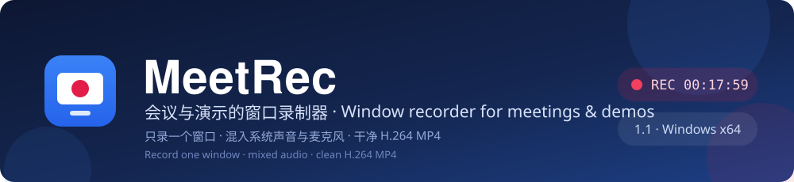
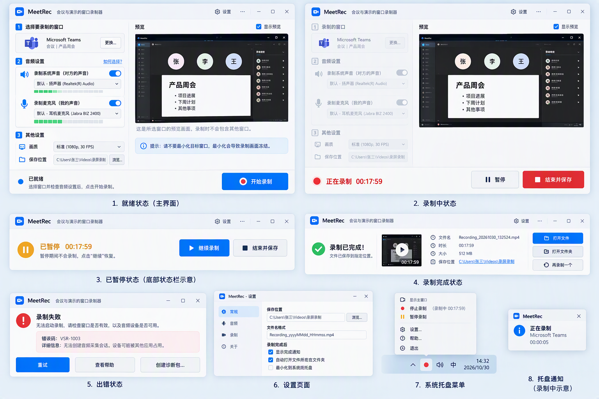
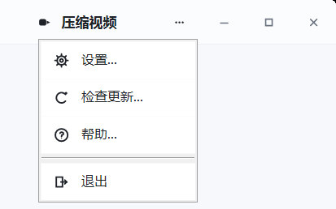
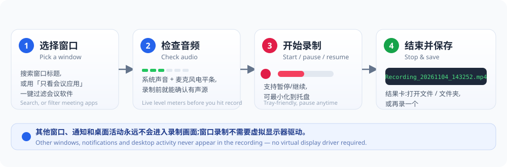
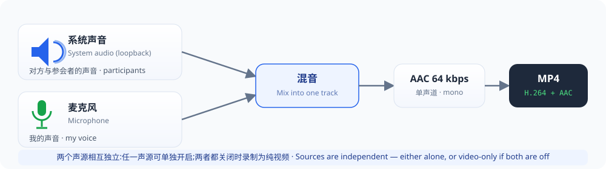
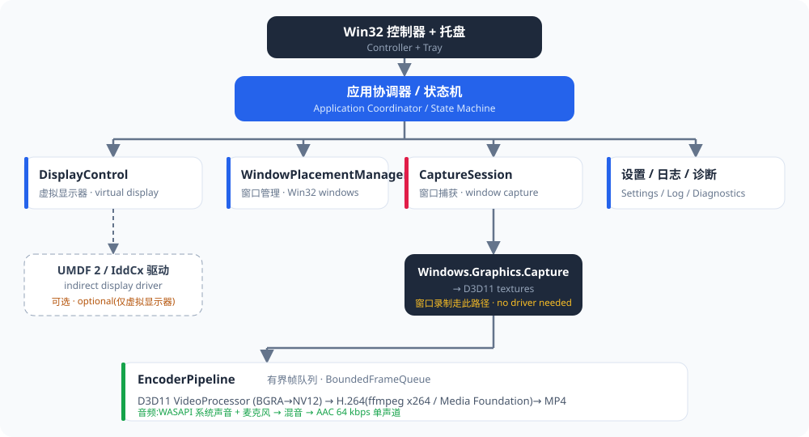

<div align="center">



[](https://github.com/ituff/meetrec/actions/workflows/build-release.yml)


[English](#english) · [简体中文](#简体中文) · [📖 使用手册 Wiki / User Manual](https://github.com/ituff/meetrec/wiki)

</div>

---

# English

**MeetRec (Virtual Screen Recorder)** is a lightweight Windows 10/11 **window recorder for
meetings and demos**: pick **one** application window, optionally mix in system audio (the
other participants) and your microphone, and save a clean **H.264 MP4**. Other windows,
notifications, and desktop activity never appear in the recording — and window recording
needs no virtual display driver and no admin rights.

The product UI is a custom-drawn native Win32 + GDI+ interface (see
[`docs/design/`](docs/design/)). The executable is `MeetRec.exe`; the settings/log directory
keeps the legacy `VirtualScreenRecorder` name so existing users retain their configuration.

| | |
|---|---|
| OS | Windows 10 2004+ x64 (build 19041+) or Windows 11 x64 |
| GPU | Direct3D 11 capable GPU with current vendor driver |
| Rights | No admin rights, no installer (portable), no driver needed |
| Output | H.264 + AAC in MP4 (SDR, 8-bit), per-preset quality |

Not supported: Remote Desktop, Windows Sandbox, GPU-less servers, 32-bit x86, ARM64,
HDR/H.265/AV1/4K. See [docs/known-limitations.md](docs/known-limitations.md).

<p align="center">
  <br>
  <sub>The product UI in its eight states: ready → recording → paused → finished, plus error,
  settings, tray menu and the recording toast. Composite shows 1.5.1; since 1.5.2 the title
  bar has a single ⋯ More menu (Settings inside) next to Compress videos:</sub>
</p>

<p align="center">
  <br>
  <sub>Since 1.5.2: Compress videos + the ⋯ More menu (Settings / Check for updates / Help / Exit).</sub>
</p>

## How it works

<p align="center">
  
</p>

## Features

- **Window-only capture** via Windows.Graphics.Capture — the target is recorded in place;
  nothing else leaks into the frame.
- **Independent audio sources**: WASAPI loopback (system/participants) and microphone, either
  or both, mixed into one AAC track; video-only when both are off.
- **Mute the recorded microphone** during a recording from the footer button, tray menu, or
  `Ctrl+Alt+M`; muting the microphone in Windows Sound settings is followed automatically.
  A meeting app's own Mute button is internal to that app and cannot be detected — this control
  only affects the recording, never what the meeting hears.
- **Live level meters** start as soon as a window is selected, so both sources can be verified
  *before* recording; meters stay live while capturing.
- **Full state machine**: Ready, Preparing, Recording, Paused, Saving, a result card
  (file name/duration/size/path with Open file / Open folder / Record again) and an actionable
  error card with Retry / Help / Diagnostics.
- **Compress older recordings** (title-bar **Compress videos** button or tray
  menu): re-encode existing MP4/MKV screen recordings from any app with the same
  screen-content recipe, at below-normal priority and paused while MeetRec is recording.
  Originals are never modified; output is `<name>-min.mp4`.
- **Local meeting transcript (P1, opt-in)**: with the SenseVoiceSmall int8 model pack,
  MeetRec recognizes the two audio sources independently and writes a speaker-labelled
  `<recording>.srt` and `.txt` next to the MP4, and shows a sentence-level click-through
  caption overlay over the recorded window. The first enable offers to download the model
  (~155 MB) with progress and cancel; an offline model zip is also published. An optional
  live translation (Bing/Edge free endpoint, target language selectable) shows the original
  and translation together; only the recognized text is sent online, never audio. Everything
  else runs on this PC. Toggle captions from the footer **CC icon** button (hover for a hint), Settings → Captions,
  the tray menu, or `Ctrl+Alt+S`; font, size, text color and anchor are configurable.
- **Window picker** with search, app icons and a **Meeting apps only** filter (Teams, Zoom,
  Tencent Meeting/Wemeet, VooV, DingTalk, Feishu/Lark, WeCom, Webex, Skype, GoToMeeting,
  BlueJeans, Huawei Cloud Meeting, Google Meet in a browser).
- **Settings** (General / Audio / Recording / Captions / About) behind the single title-bar **⋯ More**
  menu, owner-drawn tray menu (Open / Pause-Resume / Stop / Settings / Compress videos /
  Check for updates / Help / Exit), and a non-activating recording toast. Draggable splitter
  between settings and preview (double-click restores the 40/60 default; ratio persists in
  `settings.json`).
- **i18n**: Simplified Chinese primary, English included; language follows the Windows display
  language by default and can be overridden in **Settings → General → Language**
  (`system` / `zh-CN` / `en-US`). Stable `VSR-*` error codes gain localized
  titles/explanations.
- **Keyboard accessible**: Tab/Shift+Tab, Enter/Space, arrow keys on dropdowns, Esc; menus use
  native `TrackPopupMenu` semantics.

## Download and run

1. Grab `MeetRec-<version>-win64-with-ffmpeg.zip` from
   [Releases](https://github.com/ituff/meetrec/releases/latest).
2. Extract the **whole** folder to a writable directory (e.g. `D:\Apps\MeetRec`) — `ffmpeg.exe`,
   `ffprobe.exe` and their DLLs must stay next to `MeetRec.exe`.
3. Double-click `MeetRec.exe`. On the first launch Windows SmartScreen may warn about an
   unsigned publisher — choose *More info → Run anyway*.
4. No admin rights, no VC++ runtime, no driver required (C++ runtime is statically linked and
   ffmpeg is bundled).

A step-by-step illustrated manual is published on the
**[Wiki](https://github.com/ituff/meetrec/wiki)**
([中文](https://github.com/ituff/meetrec/wiki/Manual-zh) /
[English](https://github.com/ituff/meetrec/wiki/Manual-en)); offline copies live in
[`docs/user-manual.zh.md`](docs/user-manual.zh.md) /
[`docs/user-manual.en.md`](docs/user-manual.en.md).

## Record a meeting (recommended)

<p align="center">
  
</p>

- Use the **Standard** preset (1920×1080 @ 30 FPS — 60 FPS buys nothing for slides or talking
  heads). Recording uses capped constant-quality rate control (x264 CRF, or the GPU encoder's
  CQ mode) with a 5-second keyframe interval and mono 64 kbps AAC, so static slides spend few
  bits and text stays sharp — file sizes land in the same range as Teams cloud recordings
  instead of 3–4× larger.
- Enable **both** System audio and Microphone; select the **same devices the meeting app uses**
  (Teams/Zoom/Tencent Meeting keep their own device selection, which can differ from the
  Windows default — recording the wrong endpoint leaves that source silent).
- **Wear headphones**: without them the microphone also picks up the speakers and the recording
  contains an echo of the participants.
- **Meeting-app mute does not mute the recording.** Zoom/Teams/Tencent Meeting keep their mute
  state inside the app and leave the Windows microphone endpoint live, so MeetRec keeps
  recording your voice. Use the footer microphone button, the tray menu, or `Ctrl+Alt+M` to
  mute the recording (it does not affect what the meeting hears). Muting the microphone in
  Windows Sound settings is detected and removes it from the recording automatically.
- **Do not minimize** the target window while recording — Windows may stop redrawing it and the
  video freezes (the UI shows this hint).
- If your voice is quieter than the participants, set `VSR_MIC_GAIN` (0.25–8.0, default 1.0).

## Build from source

Prerequisites: **Visual Studio 2022** (or Build Tools) with the *Desktop development with C++*
workload — tested with MSVC 14.44 (v143) and Windows SDK **10.0.26100.0**. C++/WinRT headers
ship with the SDK. The optional UMDF driver additionally needs the matching
[WDK](https://learn.microsoft.com/windows-hardware/drivers/download-the-wdk).

```powershell
# Application + tests (works without the WDK)
powershell -File scripts\build.ps1 -Configuration Debug -SkipDriver

# Full build including the UMDF virtual display driver (requires WDK)
powershell -File scripts\build.ps1 -Configuration Debug

# Run the unit tests / clean
powershell -File scripts\test.ps1
powershell -File scripts\clean.ps1
```

The first build fetches the pinned, checksum-verified sherpa-onnx runtime into
`artifacts/third_party/` (cached afterwards). Meeting transcription also needs the separate
model pack; it is not required to build or record:

```powershell
# Optional ~230 MB model pack (put it next to the exe for local runs)
powershell -File scripts\fetch-speech-model.ps1 -Destination artifacts\Debug\app\models\sensevoice

# Or point the app at an existing pack
$env:VSR_SPEECH_MODEL_DIR = "D:\Models\sensevoice"
MeetRec.exe --speech-test sample16k.wav --out artifacts\speech-smoke
```

Outputs follow the artifact convention (design.md §7.3):

```text
artifacts/<Configuration>/
  app/MeetRec.exe                     # controller application
  driver/VirtualDisplayDriver.*       # UMDF driver package (WDK builds only)
  tests/UnitTests.exe                 # unit test runner
  tests/MediaValidator.exe            # test-only MP4 validation tool
  obj/…                               # static libraries and intermediates
  build-manifest.json                 # tool versions + commit id
```

## Automated builds

`.github/workflows/build-release.yml` builds the Windows x64 Release package on a
`windows-2022` runner: `src/App/App.rc` provides the version (a `v*` tag must match it),
Release build with `-SkipDriver` plus the full Release unit suite, pinned BtbN FFmpeg n9.0
download verified against `checksums.sha256`, packaging into
`MeetRec-<version>-win64-with-ffmpeg.zip`, a bundled-ffmpeg/libx264 smoke encode, and on a
`v*` tag push a GitHub Release with the zip and `SHA256SUMS.txt`. PRs and manual dispatches
build/test/package without publishing. The hosted runner has no D3D11 video processor, so CI
verifies compilation, tests, packaging and ffmpeg — hardware recording is covered by local
runs.

## Architecture

<p align="center">
  
</p>

All first-party modules are static libraries linked into `MeetRec.exe` (NFR-033); the optional
UMDF 2 / IddCx virtual display driver (derived from Microsoft's
[IndirectDisplay sample](https://github.com/microsoft/Windows-driver-samples/tree/main/video/IndirectDisplay),
MIT) remains a separate binary (NFR-034). Driver staging scripts:
`scripts/testsign.ps1`, `scripts/install-driver.ps1`, `scripts/remove-driver.ps1` — the
test-signed driver requires Windows Test Mode on dedicated dev machines only
(see [docs/sample-audit-idd.md](docs/sample-audit-idd.md)).

## Developer CLI

```text
MeetRec.exe                              # controller UI (also creates the tray icon)
MeetRec.exe --dev-record ...             # headless virtual-display recording
MeetRec.exe --dev-record-window ...      # headless window recording
MeetRec.exe --self-check                 # read-only capability report (support tool)
MeetRec.exe --encode-test ...            # full encode-pipeline validation without a driver
MeetRec.exe --speech-test WAV [--model DIR] [--out BASE]
                                         # run VAD + SenseVoice over a 16-bit PCM WAV
MeetRec.exe --download-speech-model      # download/install the transcript model (CLI)
MeetRec.exe --translate-test "TEXT" --to en
                                         # test the free Bing/Edge translation client
MeetRec.exe --caption-translate-test "TEXT" --to en
                                         # test CaptionFeed -> translator -> feed
MeetRec.exe --compress FILE [--output DIR] [--preset low|standard|high]
                                         # compress one existing recording
MeetRec.exe --compress-window [FILE...]  # open the compressor window, optionally pre-filled
MeetRec.exe --dev-compete FILE [--seconds N] [--output DIR]
                                         # baseline vs. transcode/recording drop test
MeetRec.exe --update-check               # print the latest GitHub release vs. this build
MeetRec.exe --update-self-test           # check, download, verify and apply an update
MeetRec.exe --update-window              # open the update window when a check finds one
```

| Flag | Meaning |
|---|---|
| `--seconds N` | Fixed recording duration |
| `--preset low\|standard\|high` | Quality preset |
| `--output DIR` | Output directory |
| `--encoder auto\|hardware\|software` | Encoder selection: auto/software use x264, hardware uses the detected GPU encoder (QSV/NVENC/AMF) |
| `--backend ffmpeg\|mf\|auto` | Recording backend; `auto` prefers ffmpeg, falls back to MF |
| `--audio` | Add system audio (loopback) + microphone, mixed into one AAC track |
| `--transcript` | With `--audio`: write `<recording>.srt`/`.txt` next to the MP4 |
| `--audio-out/-in <endpoint-id>` | Pin the recorded render/capture endpoints |

Exit codes for `--dev-record`: `0` success · `2` driver/display missing · `3` start rejected ·
`4` never reached Recording · `5` stopped with error.

The default (`--backend auto`) encodes through an **ffmpeg.exe child process** when ffmpeg is
available (`VSR_FFMPEG_PATH`, the application directory, `PATH`, or `C:\ffmpeg\bin`) and
through the Media Foundation sink writer otherwise — bypassing the OS media stack whose
encoder MFTs are unreliable on some Insider builds. Support-only audio dumps:
`VSR_AUDIO_DUMP_LOOPBACK`, `VSR_AUDIO_DUMP_MIC`, `VSR_AUDIO_DUMP`; `VSR_MIC_DISABLE=1` forces
a system-only run.

Data locations (per user): `%LOCALAPPDATA%\VirtualScreenRecorder\` (`settings.json`,
`Logs\`, `Diagnostics\`). The optional speech model pack lives in `models\sensevoice\` next to
`MeetRec.exe` (or the path in `VSR_SPEECH_MODEL_DIR`).

## Testing

- **Unit tests** (`tests/UnitTests`, 64 tests): state machine transitions, pause-aware
  timestamp math, bounded-queue policy, settings/JSON round trips, output naming, disk guards,
  encoder selection, error-code strings, identity matching, log redaction.
- **Media validation** (`tests/IntegrationTests/MediaValidator`): Source Reader based MP4
  validator (container, H.264 stream, dimensions, fps, timestamps, full decode, duration).
- **Integration**: `tests/IntegrationTests/IntegrationTests.ps1` (end-to-end on a machine with
  the driver installed).
- **Manual**: [docs/manual-test-checklist.md](docs/manual-test-checklist.md); traceability in
  [docs/requirements-traceability-matrix.md](docs/requirements-traceability-matrix.md).

## Documentation map

```text
docs/
  adr/                       # architecture decision records (ADR-001..ADR-006)
  design/                    # product UI design brief, annotated mockups
  release/                   # release notes + portable package README
  known-limitations.md       # user-facing limitations and unsupported scenarios
  manual-test-checklist.md   # release qualification checklist
  requirements-traceability-matrix.md
  user-manual.zh.md / user-manual.en.md   # user manuals (Wiki copies)
specs/001-mvp/               # spec, requirements, design, tasks (VSR-MVP-001 v1.0)
installer/MeetRecSetup.iss   # Inno Setup project (internal MVP)
scripts/                     # build / test / clean / driver staging
```

Project status: P0 MVP complete; P1 items implemented beyond baseline are listed in
[docs/task-completion-notes.md](docs/task-completion-notes.md).

## License / attribution

Driver code in `src/Driver` is derived from Microsoft's
[Windows-driver-samples IndirectDisplay](https://github.com/microsoft/Windows-driver-samples)
sample (MIT License, Copyright (c) Microsoft Corporation); the bundled FFmpeg is GPLv3 with
license text staged next to the executable. The optional speech runtime is
[sherpa-onnx](https://github.com/k2-fsa/sherpa-onnx) (Apache-2.0); the SenseVoiceSmall model
pack is distributed separately under the FunASR Model Open Source License Agreement v1.1 with
its license text and attribution included. All other first-party code is part of the Virtual
Screen Recorder project. See [docs/sample-audit-idd.md](docs/sample-audit-idd.md).

---

# 简体中文

**MeetRec(Virtual Screen Recorder)** 是一款轻量的 Windows 10/11 **会议/演示窗口录制器**:
只选**一个**应用窗口,可同时混入系统声音(对方/参会者)和麦克风(我的声音),输出干净的
**H.264 MP4**。其他窗口、通知和桌面活动永远不会出现在录制画面中——窗口录制不需要虚拟
显示器驱动,也不需要管理员权限。

产品界面为自绘的原生 Win32 + GDI+ 界面(见 [`docs/design/`](docs/design/))。可执行文件为
`MeetRec.exe`;设置/日志目录沿用旧名 `VirtualScreenRecorder`,老用户的配置不受影响。

| | |
|---|---|
| 操作系统 | Windows 10 2004+ x64(build 19041+)或 Windows 11 x64 |
| GPU | 支持 Direct3D 11 的显卡及厂商驱动 |
| 权限 | 无需管理员、免安装(便携)、无需驱动 |
| 输出 | H.264 + AAC 的 MP4(SDR,8-bit),按画质预设 |

不支持:远程桌面、Windows 沙盒、无 GPU 服务器、32 位 x86、ARM64、HDR/H.265/AV1/4K。
详见 [docs/known-limitations.md](docs/known-limitations.md)。

<p align="center">
  <br>
  <sub>产品界面八种状态:就绪 → 录制中 → 已暂停 → 录制完成,以及出错、设置、托盘菜单与录制通知。
  配图截自 1.5.1;1.5.2 起标题栏合并为「压缩视频」+「⋯」菜单:</sub>
</p>

<p align="center">
  <br>
  <sub>1.5.2 起的标题栏:压缩视频 + ⋯ 菜单(设置 / 检查更新 / 帮助 / 退出)。</sub>
</p>

## 工作流程

<p align="center">
  
</p>

## 功能特性

- **只录一个窗口**:基于 Windows.Graphics.Capture,原位录制目标窗口,其他内容不会入镜。
- **音频声源相互独立**:WASAPI loopback(系统/对方)与麦克风,可任选或同时开启,混入一条
  AAC 音轨;两者都关闭时录制为纯视频。
- **录制中可静音麦克风**:底部麦克风按钮、托盘菜单或 `Ctrl+Alt+M`;在 Windows 声音设置里
  静音麦克风会被自动跟随。会议软件自己的静音按钮对其他程序不可见——此开关只影响录像,
  不会改变会议里对方听到的声音。
- **实时电平条**:选中窗口后立即显示系统声音与麦克风电平(共享模式检测),录制前即可确认
  声源;录制中电平条持续更新。
- **完整状态覆盖**:就绪、准备中、录制中、已暂停、正在保存、结果卡(文件名/时长/大小/路径,
  打开文件 / 打开文件夹 / 再录一个)以及可操作的错误卡(重试 / 查看帮助 / 创建诊断包)。
- **压缩旧录屏**(标题栏 **压缩视频** 按钮或托盘菜单均可打开):把其他软件录制的
  MP4/MKV 用同一套屏幕内容编码配方重新压小;转码以低优先级运行,MeetRec 录制期间自动暂停。
  原文件不会被修改,输出为 `<原名>-min.mp4`。可选**硬件加速**(自动检测 Intel QSV / NVIDIA
  NVENC / AMD AMF),默认仍用 CPU 编码以保证文件最小;硬件编码失败会自动回退。
- **本地会议转录(P1,可选)**:首次开启时程序会提示下载 SenseVoiceSmall int8 模型
  (约 155 MB,带进度条和取消),之后分别识别系统声音(对方)和麦克风(我),录制结束在 MP4
  旁生成带说话人标签的 `<录制名>.srt` 与 `.txt`,并在录制窗口上方显示句级、可点击穿透的
  实时字幕。可选**实时翻译**(Bing/Edge 免费接口,目标语言可选),浮层同时显示原文与译文;
  只有识别出的文字会发到在线服务,音频不会上传。其余识别全程本机完成;可用主界面底部的字幕图标
  按钮(悬停显示提示)、托盘菜单或 `Ctrl+Alt+S` 开关字幕;字体、字号、颜色、位置和翻译在
  「设置 → 字幕」中调整。
- **窗口选择器**:支持搜索、应用图标,以及**「只看会议应用」筛选**(Teams、Zoom、腾讯会议、
  VooV、钉钉、飞书、企业微信、Webex、Skype、GoToMeeting、BlueJeans、华为云会议、浏览器
  Google Meet)。
- **设置窗口**(常规 / 音频 / 录制 / 字幕 / 关于,从标题栏「⋯」菜单打开)、自绘托盘菜单(打开 /
  暂停-继续 / 停止 / 设置 / 压缩视频 / 检查更新 / 帮助 / 退出)、非激活的录制通知卡片;
  设置列与预览之间可拖动分割条(双击恢复默认 40/60,比例保存在 `settings.json`)。
- **中英文界面**:简体中文为主语言,内置英文;默认跟随 Windows 显示语言,可在
  **设置 → 常规 → 语言** 覆盖(`system` / `zh-CN` / `en-US`)。错误码保留稳定的 `VSR-*`
  标识,并提供本地化的标题与说明。
- **键盘可达**:Tab/Shift+Tab 移动焦点,Enter/Space 激活,方向键操作下拉框,Esc 关闭;
  菜单使用原生 `TrackPopupMenu` 语义。

## 下载与运行

1. 从 [Releases](https://github.com/ituff/meetrec/releases/latest) 下载
   `MeetRec-<版本>-win64-with-ffmpeg.zip`。
2. 将**整个**压缩包解压到可写目录(例如 `D:\Apps\MeetRec`)——`ffmpeg.exe`、`ffprobe.exe` 及其 DLL 必须
   与 `MeetRec.exe` 在同一目录。
3. 双击 `MeetRec.exe`。首次运行 Windows SmartScreen 可能提示"未知发布者",选择
   *更多信息 → 仍要运行*。
4. 无需管理员、无需 VC++ 运行库(已静态链接)、无需驱动(已内置 ffmpeg)。

图文并茂的分步使用手册发布在 **[Wiki](https://github.com/ituff/meetrec/wiki)**
([中文](https://github.com/ituff/meetrec/wiki/Manual-zh) /
[English](https://github.com/ituff/meetrec/wiki/Manual-en));离线副本见
[`docs/user-manual.zh.md`](docs/user-manual.zh.md) /
[`docs/user-manual.en.md`](docs/user-manual.en.md)。

## 录制会议(推荐设置)

<p align="center">
  
</p>

- 使用**标准**画质(1920×1080 @ 30 FPS——幻灯片和人像 60 FPS 没有收益)。x264 采用
  capped-CRF 恒定质量码控(预设码率只作上限)、5 秒关键帧间隔、单声道 64 kbps AAC:
  静态幻灯片几乎不耗码率、文字保持锐利,文件大小与 Teams 云录制同一量级,而不是早期
  码率目标设置的 3–4 倍。
- 同时开启**系统声音**与**麦克风**;在两个设备选择器中选择**会议软件正在使用的设备**
  (Teams/Zoom/腾讯会议有自己的设备选择,可能与 Windows 默认不同——录错端点会导致该声源
  无声)。
- **戴耳机**:外放会让麦克风同时录到对方声音,录制里出现参会者回声。
- **会议软件里按静音不会静音录像。** Zoom/Teams/腾讯会议的静音状态只在它自己进程内,
  Windows 采集端点仍在工作,所以 MeetRec 仍会录到你的声音。需要静音时用底部麦克风按钮、
  托盘菜单或 `Ctrl+Alt+M`(只影响录像,不影响会议软件)。在 Windows 声音设置里静音麦克风
  会被自动识别并从录像中剔除。
- 录制期间**不要最小化**目标窗口——Windows 可能停止重绘导致画面冻结(界面内有提示)。
- 如果自己的声音比参会者轻,可设置 `VSR_MIC_GAIN`(0.25–8.0,默认 1.0)。

## 从源码构建

前置条件:**Visual Studio 2022**(或 Build Tools)勾选 *Desktop development with C++*——
已测工具链 MSVC 14.44(v143)+ Windows SDK **10.0.26100.0**;C++/WinRT 头文件随 SDK 提供。
可选的 UMDF 驱动还需匹配的
[WDK](https://learn.microsoft.com/windows-hardware/drivers/download-the-wdk)。

```powershell
# 应用 + 测试(无需 WDK)
powershell -File scripts\build.ps1 -Configuration Debug -SkipDriver

# 完整构建(含 UMDF 虚拟显示器驱动,需 WDK)
powershell -File scripts\build.ps1 -Configuration Debug

# 运行单元测试 / 清理
powershell -File scripts\test.ps1
powershell -File scripts\clean.ps1
```

首次构建会下载并校验固定版本的 sherpa-onnx 运行时到 `artifacts/third_party/`(之后复用缓存)。
会议转录还需要单独的模型包;构建和录制本身不依赖它:

```powershell
# 可选:约 230 MB 的模型包(本地运行时放到 exe 旁)
powershell -File scripts\fetch-speech-model.ps1 -Destination artifacts\Debug\app\models\sensevoice

# 或用环境变量指定已有模型目录
$env:VSR_SPEECH_MODEL_DIR = "D:\Models\sensevoice"
MeetRec.exe --speech-test sample16k.wav --out artifacts\speech-smoke
```

产物遵循 artifact 约定(design.md §7.3):

```text
artifacts/<Configuration>/
  app/MeetRec.exe                     # 控制器应用
  driver/VirtualDisplayDriver.*       # UMDF 驱动包(仅 WDK 构建)
  tests/UnitTests.exe                 # 单元测试运行器
  tests/MediaValidator.exe            # 测试专用 MP4 校验工具
  obj/…                               # 静态库与中间产物
  build-manifest.json                 # 工具版本 + 提交 ID
```

## 自动构建

`.github/workflows/build-release.yml` 在 `windows-2022` runner 上构建 Windows x64 Release
包:版本号取自 `src/App/App.rc`(`v*` 标签必须匹配),以 `-SkipDriver` 做 Release 构建 +
完整 Release 单元测试,下载固定的 BtbN FFmpeg n9.0 并校验 `checksums.sha256`,打包为
`MeetRec-<版本>-win64-with-ffmpeg.zip`,执行内置 ffmpeg/libx264 冒烟编码;推送 `v*` 标签时
发布(或更新)GitHub Release(附 zip 与 `SHA256SUMS.txt`)。PR 与手动触发只构建/测试/打包,
不发布。托管 runner 没有 D3D11 视频处理器,CI 覆盖编译、测试、打包与 ffmpeg;硬件录制由
本地运行验证。

## 架构

<p align="center">
  
</p>

所有第一方模块均为静态库,链接进 `MeetRec.exe`(NFR-033);可选的 UMDF 2 / IddCx 虚拟显示
器驱动(派生自微软
[IndirectDisplay 示例](https://github.com/microsoft/Windows-driver-samples/tree/main/video/IndirectDisplay),MIT)
保持为独立二进制(NFR-034)。驱动相关脚本:`scripts/testsign.ps1`、
`scripts/install-driver.ps1`、`scripts/remove-driver.ps1`——测试签名的驱动需要开启
Windows 测试模式,仅限专用开发机(见 [docs/sample-audit-idd.md](docs/sample-audit-idd.md))。

## 开发者命令行

```text
MeetRec.exe                              # 控制器界面(同时创建托盘图标)
MeetRec.exe --dev-record ...             # 无界面虚拟显示器录制
MeetRec.exe --dev-record-window ...      # 无界面窗口录制
MeetRec.exe --self-check                 # 只读能力报告(支持/诊断工具)
MeetRec.exe --encode-test ...            # 无驱动的完整编码管线验证
MeetRec.exe --speech-test WAV [--model DIR] [--out BASE]
                                         # 对 16-bit PCM WAV 跑 VAD + SenseVoice
MeetRec.exe --download-speech-model      # 下载并安装会议转录模型（命令行）
MeetRec.exe --translate-test "TEXT" --to en
                                         # 测试 Bing/Edge 免费翻译客户端
MeetRec.exe --caption-translate-test "TEXT" --to en
                                         # 测试字幕 feed -> 翻译 -> feed
MeetRec.exe --compress FILE [--output DIR] [--preset low|standard|high]
                                         # 压缩单个已有录制文件
MeetRec.exe --compress-window [FILE...]  # 打开压缩窗口,可预填文件
MeetRec.exe --dev-compete FILE [--seconds N] [--output DIR]
                                         # 基线 vs. 转码竞争的丢帧对比测试
MeetRec.exe --update-check               # 打印最新 GitHub Release 与本版本
MeetRec.exe --update-self-test           # 检查、下载、校验并应用更新
MeetRec.exe --update-window              # 检查到更新时直接打开更新窗口
```

| 参数 | 含义 |
|---|---|
| `--seconds N` | 固定录制时长 |
| `--preset low\|standard\|high` | 画质预设 |
| `--output DIR` | 输出目录 |
| `--encoder auto\|hardware\|software` | 编码器选择:auto/software 用 x264,hardware 用检测到的 GPU 编码器(QSV/NVENC/AMF) |
| `--backend ffmpeg\|mf\|auto` | 录制后端;`auto` 优先 ffmpeg,回退 MF |
| `--audio` | 加入系统声音(loopback)+ 麦克风,混入一条 AAC 音轨 |
| `--transcript` | 配合 `--audio`:在 MP4 旁生成 `<录制名>.srt`/`.txt` |
| `--audio-out/-in <endpoint-id>` | 指定录制回放/捕获端点 |

`--dev-record` 退出码:`0` 成功 · `2` 驱动/显示器不可用 · `3` 启动被拒绝 ·
`4` 超时未进入录制 · `5` 录制因错误停止。

默认(`--backend auto`)在 ffmpeg 可用时通过 **ffmpeg.exe 子进程**编码(`VSR_FFMPEG_PATH`、
应用目录、`PATH` 或 `C:\ffmpeg\bin`),否则通过 Media Foundation sink writer——绕开在部分
Insider 版本上不稳定的系统媒体栈编码器。设置里的「编码方式」选**硬件编码(GPU)**时,ffmpeg
后端会先用一次短测试编码检测 QSV/NVENC/AMF,再用于录制;CPU 占用明显下降,并使用与压缩
相同的恒定质量码控,文件体积与压缩结果接近;硬件不可用时录制前会提示切回自动/软件。
仅用于支持的音频转储:`VSR_AUDIO_DUMP_LOOPBACK`、`VSR_AUDIO_DUMP_MIC`、
`VSR_AUDIO_DUMP`;`VSR_MIC_DISABLE=1` 强制仅系统声音。

数据位置(每用户):`%LOCALAPPDATA%\VirtualScreenRecorder\`(`settings.json`、`Logs\`、
`Diagnostics\`)。可选的语音模型包放在 `MeetRec.exe` 旁的 `models\sensevoice\`,或由
`VSR_SPEECH_MODEL_DIR` 指定。

## 测试

- **单元测试**(`tests/UnitTests`,64 项):状态机迁移、暂停感知的时间戳计算、有界队列
  策略、设置/JSON 往返、输出命名、磁盘守卫、编码器选择、错误码字符串、身份匹配、日志脱敏。
- **媒体校验**(`tests/IntegrationTests/MediaValidator`):基于 Source Reader 的 MP4 校验
  (容器、H.264 流、尺寸、fps、时间戳、完整解码、时长)。
- **集成**:`tests/IntegrationTests/IntegrationTests.ps1`(在装有驱动的机器上端到端)。
- **手工**:[docs/manual-test-checklist.md](docs/manual-test-checklist.md);需求追溯见
  [docs/requirements-traceability-matrix.md](docs/requirements-traceability-matrix.md)。

## 文档地图

```text
docs/
  adr/                       # 架构决策记录(ADR-001..ADR-006)
  design/                    # 产品 UI 设计稿与标注
  release/                   # 发布说明 + 便携包说明
  known-limitations.md       # 面向用户的限制与不支持场景
  manual-test-checklist.md   # 发布资格审查清单
  requirements-traceability-matrix.md
  user-manual.zh.md / user-manual.en.md   # 使用手册(Wiki 同步副本)
specs/001-mvp/               # 规格、需求、设计、任务(VSR-MVP-001 v1.0)
installer/MeetRecSetup.iss   # Inno Setup 工程(内部 MVP)
scripts/                     # 构建 / 测试 / 清理 / 驱动部署
```

项目状态:P0 MVP 已完成;超出基线实现的 P1 项见
[docs/task-completion-notes.md](docs/task-completion-notes.md)。

## 许可 / 致谢

`src/Driver` 中的驱动代码派生自微软
[Windows-driver-samples IndirectDisplay](https://github.com/microsoft/Windows-driver-samples)
示例(MIT 许可,Copyright (c) Microsoft Corporation);内置 FFmpeg 为 GPLv3,许可证文本
随包附带。可选语音运行时为 [sherpa-onnx](https://github.com/k2-fsa/sherpa-onnx)
(Apache-2.0);SenseVoiceSmall 模型包单独分发,遵循 FunASR Model Open Source License
Agreement v1.1,包内附带许可证与署名。其余第一方代码属于 Virtual Screen Recorder 项目。详见
[docs/sample-audit-idd.md](docs/sample-audit-idd.md)。
