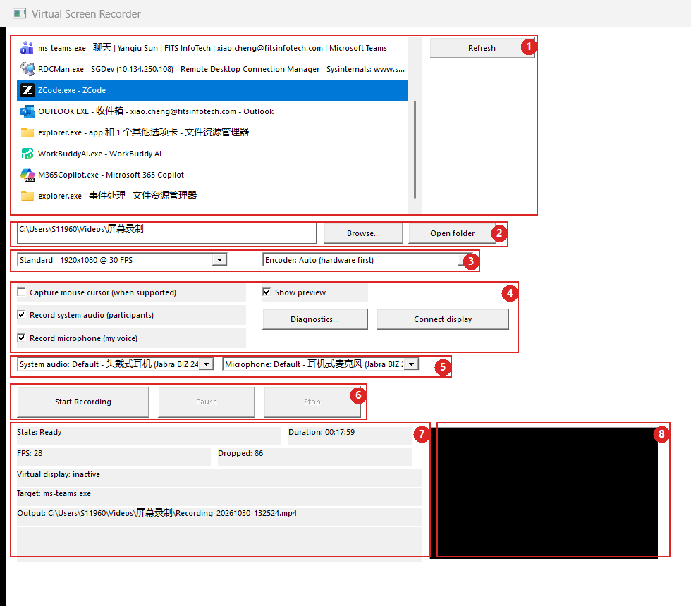
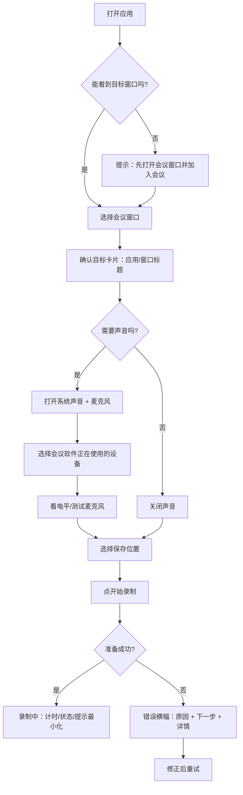
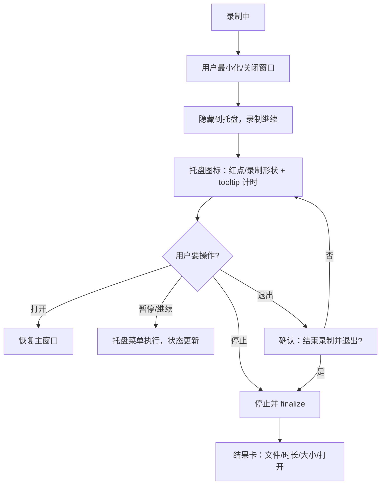
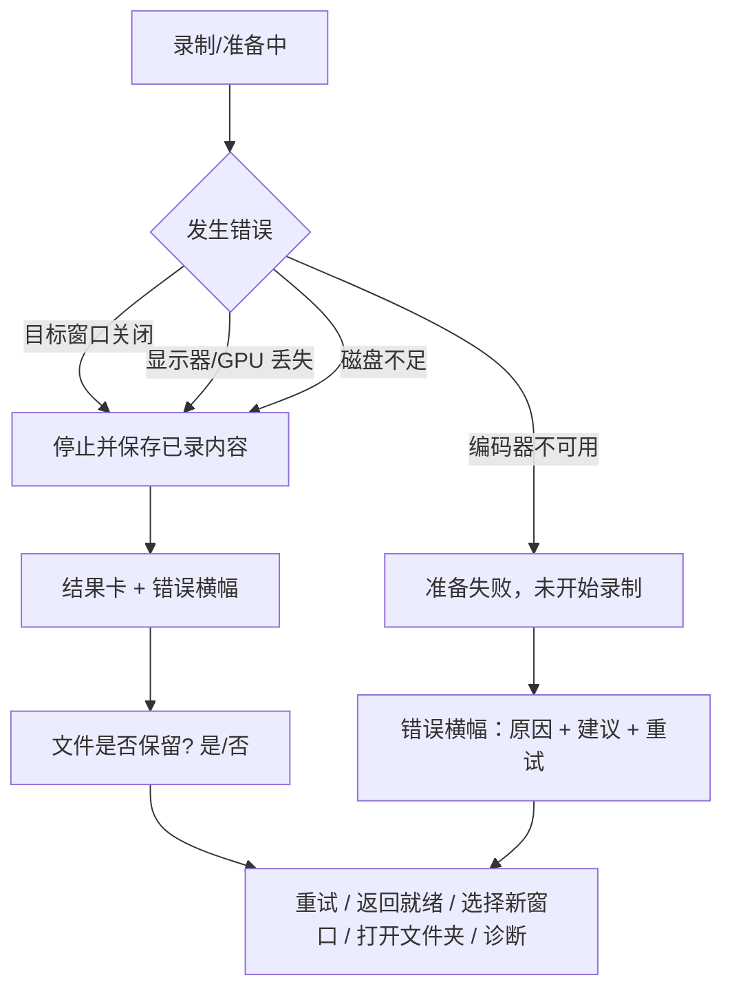

# MeetRec（当前名：Virtual Screen Recorder）UI/UX 重设计设计任务书

- **文档版本：** v1.0
- **日期：** 2026-10-30
- **面向：** 交互设计师、视觉设计师
- **产品阶段：** 1.0.0.0 已可用；本次为体验重设计，不是从零做新产品
- **配套材料：**
  - 现状截图：[current-ui-annotated.png](./current-ui-annotated.png)、[current-ui-full.png](./current-ui-full.png)
  - 现状盘点附录：[appendix-current-ui-inventory.md](./appendix-current-ui-inventory.md)
  - 产品规格：[spec.md](../../specs/001-mvp/spec.md)、[requirements.md](../../specs/001-mvp/requirements.md)
  - 用户限制说明：[known-limitations.md](../known-limitations.md)
  - 发布说明：[RELEASE-NOTES.txt](../../artifacts/dist/VirtualScreenRecorder-1.0.0.0-win64/RELEASE-NOTES.txt)

> 说明：产品名尚未最终确定。仓库名是 **MeetRec**，当前界面和安装包仍叫 **Virtual Screen Recorder**。本文暂用“MeetRec / 录制器”指代，品牌命名见第 10 节待决策项。

---

## 0. 一页纸：设计师先看这些

### 0.1 产品一句话

**把任意一个正在运行的会议或演示窗口，干净地录成 MP4；同时录下“对方的声音”和“我的声音”。**

不是录整个桌面，不是直播，不是视频编辑，也不是云服务。它解决的是：开会/演示时想留一份干净录像，但不想让通知、聊天弹窗、鼠标操作和私人窗口出现在视频里。

### 0.2 当前版本实际怎么工作

- 用户从窗口列表里选中一个应用窗口（Teams、Zoom、腾讯会议、浏览器等）。
- 录制器**原地录制这个窗口**；窗口被其他窗口挡住不影响录制。
- 目标窗口**不能最小化**，最小化会冻结画面（这是当前技术限制，必须在界面里说清楚）。
- 系统声音（对方）和麦克风（我的声音）可以混入同一条 AAC 音轨，也可以只录视频；**只录自己的声音当前不支持**（见 P0-6）。
- 录制时可以把控制窗口最小化/关闭到系统托盘，录制继续。
- 输出为 H.264 MP4，默认保存到用户的视频目录，文件名 `Recording_yyyyMMdd_HHmmss.mp4`（实际路径以界面显示为准）。
- 当前窗口录制模式**不需要虚拟显示器驱动，不需要管理员权限**，是便携版。

### 0.3 为什么现在要重设计

当前界面是随功能迭代长出来的“工程师控制面板”：

1. **主任务不突出。** 窗口列表占了最大面积，但用户真正要做的是“选一个窗口，然后开始录制”。开始按钮在底部，和一堆设置混在一起。
2. **产品已经转向窗口录制，界面还保留旧的“虚拟显示器”概念。** 普通用户看到 “Connect display / Virtual display: inactive” 会以为不连显示器就不能录，或者以为录的是整块虚拟屏幕。
3. **录制中的状态太弱。** 只有一行 “State: Recording” 和托盘里的一个小色点；窗口标题不变，最小化后用户很容易忘记自己还在录。
4. **会议录音最容易出错的地方没有设计。** 会议软件有自己的麦克风选择，常常和 Windows 默认设备不一致；选错就会“只有对方声音、没有自己的声音”。当前只有两个长下拉框，没有引导、没有电平测试。更严重的是两个开关有隐藏依赖：当前实现只有“系统声音”开关会创建音轨，默认设置却是“麦克风勾选、系统声音未勾选”，首次录制可能直接得到无声视频。
5. **出错后不可恢复。** 进入 Faulted 状态后开始按钮被禁用，界面没有“重试/返回就绪”的入口；用户只能重启应用。
6. **中文用户面对英文技术文案。** “Encoder / loopback / virtual display / Faulted” 不是目标用户的语言；设备名又是中文，界面中英文混排。

### 0.4 设计目标（一句话版）

**让一个不关心技术的会议参与者，在 3 步内开始录制，在录制中一眼确认“在录、录了多久、录的是什么”，在停止后 1 步找到文件，并且在出错时知道下一步该做什么。**

### 0.5 这次设计需要交付什么

- 信息架构 + 关键用户流程
- 主窗口所有状态的高保真稿：就绪、准备中、录制中、已暂停、正在保存、出错、空状态
- 目标窗口选择、音频设备选择、保存位置/画质、预览、录制控制、错误提示、停止后结果卡
- 托盘图标状态、托盘菜单、关闭/退出确认、首次运行/健康检查
- 组件库、设计 token、中文文案 deck、图标资产、开发标注
- 可点击原型，用于 5 人可用性测试

### 0.6 最重要的三条设计判断

1. **这是一个“会议进行中”的工具，不是“坐在电脑前慢慢配置”的工具。** 界面必须低注意力、可扫读、可恢复。
2. **“没录上 / 没录到我的声音 / 忘了在录”是三个核心风险。** 设计的价值主要体现在这三个时刻，而不是设置项有多全。
3. **原生 Windows 11 应用。** 不要做成 Web 仪表盘，不要用大面积装饰、玻璃拟态或持续动画；要克制、清楚、键盘可达。

---

## 1. 产品背景

### 1.1 用户拿它来完成什么

| 场景 | 用户要的结果 | 当前痛点 |
|---|---|---|
| 录一场 Teams / 腾讯会议 / Zoom | 视频里有对方画面，音频里有双方声音；会后能回看或发给同事 | 麦克风设备选错，自己的声音没录进去；忘记点停止；不知道该选哪个窗口 |
| 录一段产品演示 / 浏览器操作 | 画面干净，没有通知、聊天、私人窗口；文件容易找到 | 窗口列表太长；输出路径是纯文本；录完不知道文件在哪 |
| 录培训 / 业务系统操作 | 能暂停、能分段、文件不要太大 | 暂停语义不清楚；画质选项是技术参数；没有预计文件大小 |
| IT / 支持人员排查 | 知道用了哪个设备、哪个编码器、错误码是什么 | 诊断入口是一个按钮 + 弹窗；错误码混在用户文案里 |

### 1.2 产品能力边界（设计不要越界）

**有：**

- 选择一个可见的顶层应用窗口作为录制目标
- 开始 / 暂停 / 继续 / 停止
- 系统声音 + 麦克风混音（可选）
- 三档画质（低 / 标准 / 高）
- 输出目录选择、文件名自动生成、不覆盖已有文件
- 系统托盘常驻、托盘菜单、录制中关闭窗口隐藏到托盘
- 预览（录制画面的低帧率缩略预览）
- 设置持久化、诊断包、单实例
- 完全本地、无网络、无上传

**没有（本次设计也不要暗示有）：**

- 录整个桌面 / 多显示器 / 区域选择
- 摄像头、水印、标注、剪辑、转码、上传、分享链接
- 直播、推流、云录制、会议 SDK 集成
- 4K / HDR / H.265 / AV1 / 可变帧率
- 绕过 DRM、锁屏、UAC 安全桌面
- 多轨音频编辑、回声消除、自动增益（当前麦克风增益是环境变量，不是 UI）
- 后台服务、无人值守录制、多用户会话

### 1.3 当前实现与旧规格的差异（重要）

产品最初的设计是“创建一块虚拟显示器，把目标窗口移过去，再录虚拟显示器”。**当前窗口录制模式已经不再这样做**：目标窗口原地录制，不需要虚拟显示器，也不需要驱动。

但界面里仍然保留：

- `Connect display / Disconnect display` 按钮
- `Virtual display: active/inactive` 状态行
- 旧规格中的“虚拟显示器”话术

这会让普通用户产生错误心智。**本次重设计建议把虚拟显示器从主界面移除**；如果产品决定保留“录制整块虚拟屏幕”的能力，应把它放到“高级 / 实验性功能”，不要和主流程并列。此项需要产品确认（见第 10 节）。

### 1.4 产品名

- 仓库名：**MeetRec**
- 当前界面 / 安装包 / 发布说明：**Virtual Screen Recorder**
- 现状问题：名字描述的是旧方案（虚拟屏幕），不是现在的核心价值（会议/窗口录制）；英文名对中文用户也不够直观。

设计启动前需要产品拍板：是继续用 Virtual Screen Recorder，还是切换到 MeetRec / 中文名。**在拍板前，视觉设计可以使用中性占位字标，不要过早做品牌延展。**

---

## 2. 用户与使用环境

> 以下用户画像基于当前产品用途、发布说明中的真实问题和使用场景整理；如果已有正式用户访谈/问卷，请用真实数据替换或补充。

### 2.1 主要用户

#### Persona A：会议记录者（第一优先）

- 典型身份：产品、销售、项目经理、顾问、行政、需要留档的普通职场用户
- 年龄/技术能力：25–45 岁，能装软件、会用会议软件，但不理解编码器、采样率、环回音频
- 设备：公司 Windows 11 笔记本，通常 125% 或 150% 缩放；Jabra/罗技耳机或笔记本内置麦克风；单屏或双屏
- 会议软件：Teams、腾讯会议、Zoom、飞书、钉钉
- 关键行为：
  - 会前 1–2 分钟打开录制器，选会议窗口，点开始
  - 会议中把录制器最小化到托盘，继续共享屏幕/讲话
  - 会后从托盘停止，找到文件，发给同事或自己回看
- 关键担忧：
  - “我自己的声音录进去了吗？”
  - “录的是会议窗口，还是把我的聊天也录进去了？”
  - “我是不是忘了点停止？”
  - “文件在哪？”
- 设计含义：
  - 首屏必须回答“录什么、声音对不对、存哪”
  - 录制中必须有持续、低干扰的状态提示
  - 停止后必须有明确的结果卡和“打开文件/文件夹”
  - 音频设备选择必须比现在更可理解，最好有电平测试

#### Persona B：演示 / 培训录制者

- 目标：录浏览器、PPT、内部系统、产品 Demo
- 关注：画面干净、文件不要太大、能暂停、录完容易分享
- 痛点：窗口列表里有很多相似窗口；不知道“标准/高”画质差在哪；录完只看到一行路径
- 设计含义：
  - 目标窗口卡片要显示应用图标、应用名、窗口标题，避免选错
  - 画质用“720p / 1080p / 1080p60”+ 用途说明，而不是只给技术参数
  - 提供预计文件大小/时长提示（可作为 nice-to-have）

#### Persona C：IT / 支持 / 高级用户

- 目标：确认驱动/编码器/设备状态，收集日志，排查“为什么没声音/没画面”
- 关注：错误码、实际使用的音频端点、编码器、日志位置、诊断包
- 设计含义：
  - 主界面不要堆技术细节；提供“详情/诊断”入口
  - 错误提示要保留可复制的错误码和“打开日志/创建诊断包”
  - 高级设置（编码器、预览、崩溃转储、虚拟显示器）可以放在二级面板

### 2.2 Jobs to be done

- 当我马上要开一个重要的会，我想在 30 秒内确认“录的是这个窗口、双方声音都在”，然后点开始。
- 当我在会议中共享屏幕、讲话、切窗口时，我想用余光确认“还在录”，但不想被弹窗或大红条打断。
- 当我暂停去处理私事时，我想明确知道“暂停期间不会录”，继续后时间线是连续的。
- 当我停止录制时，我想立刻知道“文件保存成功了吗、在哪、多大、多长”，并能一键打开。
- 当录制失败时，我想知道“发生了什么、我的文件还在不在、我现在该点哪里”，而不是重启应用。
- 当会议软件用内置麦克风、Windows 默认是耳机时，我想被明确提醒并选对设备，而不是会后才发现自己的声音没了。

### 2.3 使用环境约束

- Windows 11 x64；Per-Monitor V2 DPI；125% / 150% 常见
- 中文系统，窗口标题和设备名经常是中英文混合
- 公司电脑可能没有管理员权限；当前窗口录制模式不需要管理员，这是卖点
- 会议软件可能占用麦克风；录制器和会议软件同时打开麦克风在多数设备上可行，但需要在文案/错误里考虑“设备被占用”
- 用户可能戴耳机，也可能外放；外放会产生回声（当前无 AEC），设计上应给一次性提示
- 用户可能在录制中切换窗口、共享屏幕、最小化会议窗口；最小化目标窗口会冻结画面，这是必须前置说明的限制
- 用户可能忘记在录；也需要考虑会议录制的知情/同意问题（法律/公司政策，见待决策）

---

## 3. 当前界面与体验现状

### 3.1 现状截图



> 截图是在 125% 缩放环境下、把窗口拉大到完整显示后截的。正常默认尺寸约 760×640（逻辑像素），控件采用固定坐标布局。

### 3.2 当前界面区域

| 编号 | 区域 | 当前内容 | 现状问题 |
|---|---|---|---|
| 1 | 目标窗口列表 | 可见顶层窗口，格式 `exe - 标题`，带图标；右侧 Refresh | 占据最大视觉面积；无搜索/过滤；无“已选中哪个”的卡片式确认；长标题被截断 |
| 2 | 保存位置 | 纯文本路径输入框 + Browse + Open folder | **没有可见标签**；用户要猜这是输出目录；没有最近文件夹；停止后不能直接打开刚录的文件 |
| 3 | 画质 / 编码器 | 两个下拉框：Standard 1920×1080@30、Encoder: Auto | 画质用技术参数；编码器是高级概念，却和画质并列；没有“推荐”标识 |
| 4 | 录制选项 | 鼠标指针、显示预览、系统声音、麦克风、Diagnostics、Connect display | 主次不分；预览开关和预览面板分离；诊断/显示器按钮混在录制选项里 |
| 5 | 音频设备 | System audio / Microphone 两个长下拉框 | 中英文混排、长设备名被截断；没有电平测试；没有“请选择会议软件正在使用的麦克风”的提示 |
| 6 | 录制控制 | Start Recording / Pause / Stop | 主按钮不突出；Start 在底部；Pause/Stop 灰色；没有录制中的红色主视觉；没有“结束并保存”的结果预期 |
| 7 | 状态区 | State / Duration / FPS / Dropped / Virtual display / Target / Output / Error | 像调试日志；Ready 状态仍显示上一次会话的时长/FPS/丢帧/目标/输出；虚拟显示器行与窗口录制无关；错误行很窄，长文案会截断 |
| 8 | 预览 | 黑色矩形 | 空闲时是黑块，看起来像坏了；默认开启；没有占位图/说明；和状态区混排 |

### 3.3 当前主流程

```text
打开应用
  → 在窗口列表里找到目标窗口（可能需要滚动/辨认 exe 名）
  → 单击选中
  → （可选）改输出目录、画质、编码器
  → （可选）勾选系统声音/麦克风，选择设备
  → 点 Start Recording
  → 准备 1–5 秒（只有 State: Preparing）
  → 录制（State: Recording；预览出现画面）
  → 最小化/关闭到托盘（只有托盘圆点变色）
  → 从托盘 Pause / Stop
  → 状态行出现 Output 路径
  → 手动打开文件夹找文件
```

### 3.4 当前做得好的地方（请保留）

- **单窗口、单页完成**：没有多级向导，启动成本低。
- **键盘可达**：标准 Win32 控件，Tab 可以走完主要功能。
- **状态机驱动按钮禁用**：不会让用户在错误状态下点错命令。
- **托盘常驻**：录制中关闭窗口隐藏到托盘，不中断录制。
- **设置持久化**：输出目录、画质、编码器、音频设备、预览开关会记住。
- **预览不影响录制**：关闭预览不会停止采集。
- **错误码稳定**：`VSR-*` 错误码可用于支持排查。
- **本地、轻量、无网络**：这是产品信任感的一部分，设计不要引入云/账号暗示。

### 3.5 现状问题清单

按“对核心任务的影响”排序。P0 = 不解决会直接影响录制成功/用户信任；P1 = 明显增加认知负担或支持成本；P2 = 打磨项。

#### P0

**P0-1 主任务没有视觉层级。**
窗口列表是最大控件，但“选择目标 → 开始录制”才是主任务。开始按钮在最底部，和画质、编码器、诊断、显示器按钮混在一起。用户第一眼不知道从哪里开始。

**P0-2 “虚拟显示器”概念误导。**
`Connect display` 和 `Virtual display: inactive` 对普通窗口录制没有意义，但会让人以为“必须先连接显示器”。用户在录制会议窗口时看到 “Virtual display: inactive” 会怀疑录制是否正常。

**P0-3 录制中状态太弱。**
录制中只有状态区的 `State: Recording` 和托盘小圆点变色；窗口标题不变，没有红色/计时器等主视觉。用户最小化到托盘后很容易忘记还在录。

**P0-4 Faulted 状态没有恢复路径。**
进入 Faulted 后 Start 被禁用，界面没有 Reset / 重试 / 返回就绪的按钮。Coordinator 有 `Reset()`，但 UI 没有接线。用户只能重启应用。

**P0-5 错误提示不可行动。**
错误只显示在 460×40 的状态行里（`Error [VSR-...]: ...`），长文案会截断；Start 失败才弹 MessageBox。没有统一的“发生了什么 / 可能原因 / 下一步”结构，也没有“打开日志/创建诊断包”的就地入口。

**P0-6 音频开关/设备选择容易出错，而且默认值有陷阱。**
会议软件有自己的麦克风设置，常常和 Windows 默认设备不同。当前两个长下拉框没有引导、没有电平测试、没有“正在使用哪个设备”的明确确认。发布说明里已经记录过真实案例：录完只有对方声音，自己的声音完全没录进去。
更严重的是：当前音频管线由“系统声音”开关启动；只勾“麦克风”不会创建音轨。默认设置是 `recordSystemAudio=false`、`recordMicrophone=true`，所以首次录制很可能是无声视频。设计上需要“录制声音”总开关 + 来源选择，或让麦克风能独立启动音轨（需工程修改）。

**P0-7 最小化目标窗口会冻结画面，但提示藏在一个很少出现的弹窗里。**
只有“没选窗口就点开始”时才会弹出包含这条提示的 MessageBox。正常选择窗口的用户永远看不到这条关键限制，直到录完发现画面冻住。

#### P1

**P1-1 设置平铺，没有“基本/高级”分层。**
输出目录、画质、编码器、鼠标指针、预览、系统声音、麦克风、诊断、显示器全部同权重。普通用户不需要理解编码器和预览开关。

**P1-2 状态区像调试日志，且包含过期数据。**
Ready 状态仍显示上一次会话的 Duration / FPS / Dropped / Target / Output。截图里 `State: Ready`、`Duration: 00:17:59`、`FPS: 28`、`Dropped: 86` 同时出现，用户无法判断这些是本次还是上次。FPS/丢帧是诊断指标，不是用户目标。

**P1-3 没有空状态/健康检查。**
没有可选窗口、没有音频设备、编码器不可用、输出目录不可写、ffmpeg 缺失等情况，当前只是空列表或 Start 时弹窗。用户不知道“现在能不能录、缺什么”。

**P1-4 预览是黑块。**
默认开启预览，但空闲时没有画面，只显示黑色矩形。看起来像故障，也占据很大面积。预览开关在左上角，面板在右下角，两者没有视觉关联。

**P1-5 停止后没有结果卡。**
停止后只有状态区一行 `Output: ...`。没有“保存成功/失败”、文件名、时长、大小、打开文件/打开文件夹/复制路径。用户要自己从长路径里找。

**P1-6 关闭/退出语义复杂且不可发现。**
录制中关闭窗口会隐藏到托盘，但这个行为由 `settings.json` 的 `minimizeToTray` 决定，界面没有开关。用户不知道“关闭”到底是退出、隐藏还是停止录制。托盘 Exit 的确认弹窗也是技术化长句。

**P1-7 中文用户面对英文界面和技术术语。**
`State: Ready`、`Faulted`、`Encoder`、`loopback`、`Virtual display`、`Dropped` 都不是目标用户的语言。设备名又是中文，形成中英文混排。

**P1-8 托盘状态只靠颜色。**
托盘图标是纯色圆点：蓝=就绪、红=录制、黄=暂停、灰=错误。色盲/高对比度/小尺寸下不可靠；没有形状/角标/文字提示。FR-085 要求“视觉区分”，但仅颜色不够。

**P1-9 窗口列表没有搜索/最近使用。**
窗口多时要在长列表里辨认 `ms-teams.exe - 聊天 | ...`。每次录制都要重新找一遍。没有“上次录制的窗口”快捷入口。

**P1-10 键盘顺序不自然。**
Tab 顺序按控件创建顺序：列表 → Refresh → 输出 → Browse → Open folder → 画质 → 编码器 → 鼠标 → 系统声音 → 麦克风 → 音频设备 → 预览 → Start → Pause → Stop → Diagnostics → Connect display。开始/暂停/停止之后才是诊断和显示器，不符合任务顺序。

#### P2

- 分组标题（Target application / Output folder / Quality）在代码里创建了，但布局时没有放置，实际界面没有分区标题。
- 窗口可以拉伸，但控件不会重排；拉大后右侧/下方留白。设计若要求自适应，需要工程实现布局重排。
- 输出目录是纯文本输入，没有最近目录、没有路径校验、没有“预计占用空间”。
- 画质没有说明“低/标准/高”分别适合什么场景；没有预计文件大小。
- 鼠标指针选项对会议录制通常无意义，可以收进高级。
- 预览没有“正在预览/已关闭”的空状态；没有占位图。
- 状态行字体是普通 Segoe UI 9pt，数字不tabular，计时器跳动时宽度会变。
- 窗口图标来自系统，尺寸/风格不统一；产品自身没有品牌图标。
- 没有暗色主题设计；标准 Win32 控件在暗色系统下表现不一致。
- 没有高对比度/屏幕阅读器的系统化设计；托盘颜色是最明显的可访问性缺口。
- 没有“录制已开始/已停止”的 toast 或声音提示；用户只能看状态行。
- 没有全局快捷键（开始/停止/暂停）；会议中要切回窗口操作。

### 3.6 不要误判为“问题”的设计约束

以下行为是有意为之，重设计时不要改掉，除非产品明确同意：

- **状态区只显示 `targetExeName`，不显示完整窗口标题。** 这是隐私选择：避免录制器自己的窗口在共享屏幕时泄露文档标题。窗口列表里可以显示完整标题，但常驻状态/托盘/日志里不要。
- **不覆盖已有文件。** 文件名冲突时会自动加后缀；不要设计“覆盖”作为默认动作。
- **录制中关闭窗口是隐藏到托盘，不是退出。** 这是为了防止误停录制。
- **退出录制中应用必须先停止并 finalize。** 不能设计“直接退出、丢弃录像”。
- **托盘菜单必须有 Open / Pause or Resume / Stop / Exit。** 这是产品要求。
- **录制中必须显示已录制时长和最近错误。** 这是产品要求。
- **Start 只在 Ready 时可用；目标/输出路径在点击时校验。** FR-070 要求目标、虚拟显示器、输出路径有效；当前 UI 是点击后才弹错。重设计建议做成就地校验（未选目标时 Start 置灰或明确提示），但不要在准备中/录制中设计“再次开始”。
- **同一 Windows 会话只能有一个录制。** 第二个实例会激活已有窗口，不会开第二个录制。
- **预览关闭不能停止录制。** 预览是可选旁路。

---

## 4. 设计目标与原则

### 4.1 目标与衡量方式

> 以下指标是建议值，用于设计评审和可用性测试；可按实际产品目标调整。

| 目标 | 用户表现 | 可用性测试指标 |
|---|---|---|
| 3 步内开始录制 | 打开 → 选窗口 → 开始 | ≥90% 用户在 60 秒内完成首次录制，无需帮助 |
| 录制中一眼确认状态 | 能看到“正在录制 + 计时 + 录的是什么” | ≥90% 用户最小化到托盘 30 秒后仍能正确说出“还在录” |
| 停止后 1 步找到文件 | 结果卡 + 打开文件/文件夹 | ≥90% 用户在 30 秒内打开刚录的文件 |
| 音频选择不出错 | 能选对会议软件使用的麦克风 | ≥80% 用户在模拟“默认麦克风错误”的场景中选对设备 |
| 错误可恢复 | 知道发生了什么、文件是否保留、下一步 | ≥80% 用户能在目标窗口关闭/磁盘不足后开始新的录制，无需重启 |
| 低干扰 | 录制中不遮挡会议、不抢焦点 | 观察：录制中无强制弹窗、无焦点抢占；托盘/悬浮提示不遮挡会议内容 |
| 原生、可访问 | 键盘可完成主流程；高对比度可用 | 100% 主流程键盘可达；对比度 ≥ WCAG AA；托盘状态不依赖颜色 |

### 4.2 设计原则

1. **一屏完成，渐进披露。**
   主界面只保留“录什么、声音、存哪、开始”四件事；编码器、鼠标指针、预览、诊断、虚拟显示器收进“高级/更多”。

2. **主操作唯一且明确。**
   任何时刻只有一个主按钮：`开始录制` 或 `结束并保存`。暂停是次操作。不要让“连接显示器”“诊断”“刷新”和主操作抢视觉权重。

3. **状态是一等公民，不是日志。**
   用状态胶囊/横幅/计时器表达“就绪/准备中/录制中/已暂停/正在保存/出错”，而不是 `State: Ready` 这种开发者文本。把 FPS/丢帧降级到详情。

4. **用用户语言，不用实现语言。**
   主界面不出现 encoder、MFT、loopback、virtual display、Faulted。技术细节放在“详情/诊断”，保留错误码供支持使用。

5. **错误必须可行动。**
   每个错误至少回答：发生了什么、我的文件还在不在、我现在能点什么。提供“重试/返回就绪/打开文件夹/创建诊断包”等动作。

6. **为“会议进行中”设计。**
   低注意力、低干扰、可扫读；不要持续动画、不要频繁 toast、不要抢焦点。录制中的提示要能在余光中识别。

7. **默认安全，破坏性操作要确认。**
   不覆盖文件；退出录制前确认并 finalize；暂停要说明“暂停期间不录制”；关闭窗口的后果要提前说清楚。

8. **可访问性是底线。**
   键盘顺序符合任务顺序；焦点可见；不只靠颜色表达状态；高对比度下仍可读；屏幕阅读器能读出控件名称和状态。

9. **原生 Windows 11，而不是网页风格。**
   使用 Segoe UI Variable / 系统图标语言 / 克制的圆角与层次；不追求 glassmorphism、渐变球、大面积插画。

### 4.3 反目标（设计不要做）

- 不要做多页向导（首次运行最多 1 页健康检查/引导）。
- 不要做仪表盘、图表、统计页。
- 不要把 FPS、丢帧、编码器、分辨率全部放在主界面。
- 不要用红色大面积铺满窗口；红色只用于“正在录制”的关键指示。
- 不要用只有颜色差异的托盘图标。
- 不要设计“自动上传/云备份/分享链接”的入口。
- 不要设计“覆盖已有文件”的默认路径。
- 不要设计需要管理员权限的流程（窗口录制模式不需要）。
- 不要设计超过 1–2 秒的持续动画；空闲 CPU 目标是 <1%。

---

## 5. 信息架构与界面建议

以下不是最终方案，而是给设计师的**起点和约束**。设计师可以提出更好的结构，但需要满足第 6 节的状态/规则和第 7 节的技术约束。

### 5.1 建议的信息架构

```text
主窗口
├─ 顶部栏
│  ├─ 产品字标（占位）
│  ├─ 当前状态胶囊：就绪 / 准备中 / 录制中 00:12:34 / 已暂停 / 正在保存 / 出错
│  └─ 更多（⋯）：设置、诊断、关于、退出
├─ 主区域
│  ├─ 1. 录制目标
│  │  ├─ 已选窗口卡片：应用图标 + 应用名 + 窗口标题 + [更换]
│  │  ├─ 未选择：空状态 + [选择窗口]
│  │  └─ 提示：录制期间不要最小化此窗口
│  ├─ 2. 声音
│  │  ├─ 录制声音（总开关）
│  │  ├─ 系统声音（对方）开关 + 设备选择 + 电平指示
│  │  ├─ 麦克风（我的声音）开关 + 设备选择 + 电平指示/测试
│  │  └─ 提示：请选择会议软件正在使用的麦克风；建议戴耳机
│  ├─ 3. 保存与画质
│  │  ├─ 保存位置：路径 + [更改] + [打开文件夹]
│  │  ├─ 画质：720p / 1080p / 1080p60（带用途说明）
│  │  └─ 高级设置（折叠）：编码器、鼠标指针、预览、崩溃转储、虚拟显示器（如保留）
│  └─ 4. 预览（可选，录制时出现；空闲时显示占位/说明）
├─ 底部操作栏
│  ├─ 就绪：[开始录制]（主按钮）
│  ├─ 录制中：[暂停]（次）+ [结束并保存]（主/危险确认）
│  ├─ 暂停：[继续]（主）+ [结束并保存]
│  └─ 保存中：进度/“正在保存，请稍候”，所有命令禁用
└─ 结果/错误区
   ├─ 停止成功：文件卡（文件名、时长、大小、路径）+ [打开文件] [打开文件夹] [复制路径]
   └─ 错误：横幅（标题 + 说明 + 动作 + 详情）
```

### 5.2 建议的主窗口线框（就绪）

```text
┌──────────────────────────────────────────────────────────────┐
│  MeetRec                         ● 就绪              ⚙   ⋯   │
├──────────────────────────────────────────────────────────────┤
│  录制目标                                                     │
│  ┌────────────────────────────────────────────────────────┐  │
│  │  [Teams 图标]  Microsoft Teams — 周会                   │  │
│  │                ms-teams.exe                            │  │
│  │                                        [更换窗口]       │  │
│  └────────────────────────────────────────────────────────┘  │
│  ⓘ 录制期间请不要最小化此窗口，否则画面会冻结。                │
│                                                              │
│  声音                                                         │
│  ☑ 录制声音                                                   │
│     ☑ 系统声音（对方）   [默认扬声器 ▾]        ▂▄▆▂         │
│     ☑ 麦克风（我的声音） [Jabra 麦克风 ▾]      ▁▃▅▂         │
│  ⓘ 请选择会议软件“设置 → 设备”里正在使用的麦克风。             │
│                                                              │
│  保存与画质                                                   │
│  C:\Users\<你>\Videos\会议录制         [更改]  [打开文件夹]    │
│  画质  [标准 · 1080p ▾]                 高级设置 ▸            │
│                                                              │
│                     [  ● 开始录制  ]                          │
└──────────────────────────────────────────────────────────────┘
```

### 5.3 建议的主窗口线框（录制中）

```text
┌──────────────────────────────────────────────────────────────┐
│  MeetRec                    ● 正在录制  00:12:34      ⚙  ⋯   │
├──────────────────────────────────────────────────────────────┤
│  [Teams 图标]  Microsoft Teams — 周会          [预览缩略图]    │
│  正在录制此窗口 · 1080p30 · 预计 1.2 GB                        │
│                                                              │
│  ⓘ 可以最小化到托盘，录制不会中断。                            │
│                                                              │
│          [ ⏸ 暂停 ]        [ ■ 结束并保存 ]                   │
└──────────────────────────────────────────────────────────────┘
```

### 5.4 建议的主窗口线框（出错/已停止）

```text
┌──────────────────────────────────────────────────────────────┐
│  MeetRec                         ⚠ 录制已停止           ⋯    │
├──────────────────────────────────────────────────────────────┤
│  目标窗口被关闭，录制在 00:08:12 自动停止。                    │
│  已保存：Recording_20261030_132524.mp4（约 640 MB）          │
│                                                              │
│  [打开文件]   [打开文件夹]   [复制路径]   [查看详情 ▸]        │
│                                                              │
│  ──────────────────────────────────────────────────────────  │
│  可以重新选择一个窗口开始新的录制。       [选择窗口] [返回就绪] │
└──────────────────────────────────────────────────────────────┘
```

### 5.5 关键设计决策与理由

| 决策 | 建议 | 理由 / 备注 |
|---|---|---|
| 目标选择 | 保留列表，但改成“已选目标卡片 + 更换”模式；列表支持搜索、按应用分组、最近使用 | 列表本身没有错，错在它抢了主任务；卡片能让用户确认“录的是这个” |
| 目标选择方式 | 列表 + 可选“点击窗口选择”（点按钮后最小化自己，让用户点目标窗口） | 后者对会议场景更自然，但工程成本高；作为 nice-to-have/二期 |
| 虚拟显示器 | 从主界面移除；如保留，放到“高级/实验性” | 窗口录制不需要；保留会制造错误心智 |
| 画质 | 用“720p / 1080p / 1080p60 + 用途说明”，技术参数放 tooltip/详情 | 用户不懂 3/6/12 Mbps，但能理解“更清晰/更流畅/文件更大” |
| 编码器 | 默认“自动（推荐）”；高级里才出现硬件/软件 | 普通用户不需要理解；出错时再解释 |
| 音频 | 一个“录制声音”总开关 + 两个来源（对方/我的声音）+ 设备选择 + 电平测试 + 明确提示 | 这是最高频的失败点；当前“只勾麦克风不建音轨”的隐藏依赖必须消除或明确表达 |
| 预览 | 默认关闭/录制时显示缩略图；空闲显示占位说明 | 黑块像故障；预览不是主任务 |
| 状态 | 顶部状态胶囊 + 录制中计时器 + 结果卡 | 状态要可扫读，不是日志 |
| FPS/丢帧 | 收进“详情/诊断”；只有异常时在主界面提示 | 普通用户不需要；支持人员需要 |
| 输出 | 结果卡 + 打开文件/文件夹/复制路径 | 停止后的第一需求是“文件在哪” |
| 关闭行为 | 在设置里暴露“关闭窗口时最小化到托盘”；录制中关闭时给一次轻量提示 | 现在由隐藏设置决定，不可发现 |
| 首次运行 | 一页健康检查/引导：能录吗、声音怎么选、窗口不能最小化 | 降低首次失败率；不要做成多步 wizard |
| 托盘 | 状态图标（形状+颜色）+ tooltip + 菜单；可选 toast/悬浮条 | 托盘是录制中的主要控制面；不能只靠颜色 |
| 文案 | 中文优先，英文可切换；技术词进“详情” | 目标用户中文；设备名中英混排要处理 |

### 5.6 关键流程

#### 流程 A：首次录制（会议）



#### 流程 B：录制中最小化到托盘



#### 流程 C：出错恢复



### 5.7 状态与界面行为契约

| 状态 | 用户看到 | 主操作 | 次操作 | 必须可见 | 禁止 |
|---|---|---|---|---|---|
| Initializing | 启动检查中（短暂） | 无 | 无 | 产品名/加载 | 显示可点击的开始 |
| Ready | 就绪；目标/声音/保存摘要；上次录制结果（如有） | 开始录制（目标有效时） | 更换窗口、设置、诊断 | 目标、声音、保存位置、开始 | 开始（无目标/路径无效） |
| Preparing | 准备中（1–5 秒）；分步提示：检查窗口/准备编码器/开始 | 无（当前状态机不支持取消） | 无 | 正在准备、目标 | 重复开始、暂停/停止 |
| Recording | 红色录制指示 + 计时；目标；输出；暂停/结束 | 结束并保存 | 暂停、最小化到托盘 | 录制中、计时、目标、结束 | 开始、更换目标、改音频设备 |
| Paused | 已暂停；计时冻结；“暂停期间不录制” | 继续 | 结束并保存 | 已暂停、已录时长 | 开始 |
| Stopping | 正在保存（最长约 10 秒）；不确定进度 | 无 | 无 | 正在保存、请稍候 | 关闭/退出/重复停止 |
| Faulted | 出错；发生了什么/文件是否保留/下一步 | 重试/返回就绪（需工程补 UI） | 打开文件夹、诊断、选择新窗口 | 错误标题、说明、动作、错误码（详情） | 开始（直到 Reset） |
| ShuttingDown | 应用退出中（短暂） | 无 | 无 | 保存/退出提示 | 任何操作 |

> 注意：当前状态机在 `Preparing` 不允许取消，`Stopping` 不允许取消。如果设计师希望提供“取消准备/取消保存”，需要产品与工程评估，不能只画在稿子里。

### 5.8 空状态与健康检查清单

| 场景 | 用户应该看到 | 主行动 |
|---|---|---|
| 没有可选窗口 | “还没有可录制的窗口。先打开会议或演示窗口，再加入会议。” | [重新扫描] |
| 目标窗口已关闭 | “这个窗口已经关闭，录制已停止并保存。” | [打开文件] [选择新窗口] |
| 没有音频设备 | “没有检测到麦克风/扬声器。可以继续录视频，或接入设备后重试。” | [重新检测] [仅录视频] |
| 麦克风被占用 | “麦克风可能被会议软件占用。可以先开始录制；如果自己的声音没有录上，请在会议软件和设备列表中选择同一设备。” | [继续] [更换设备] |
| 输出目录不可写 | “这个文件夹不能写入。请选择‘视频’或文档目录。” | [更改位置] |
| 磁盘空间不足 | “剩余空间不足。预计需要 X GB，当前只剩 Y GB。” | [清理空间] [更换位置] |
| 编码器不可用 | “这台电脑暂时无法编码视频。请更新显卡驱动，或切换到软件编码。” | [重试] [打开诊断] |
| 首次运行/健康检查 | “可以录制。建议戴耳机；录制期间不要最小化会议窗口。” | [开始第一次录制] |
| 上次录制未完成 | “上次录制没有正常结束，可能留下 .partial.mp4 文件。” | [打开文件夹] [查看详情] |

### 5.9 停止后的结果卡（关键）

停止后的第一需求不是“看状态”，而是“文件在哪、成功了吗”。结果卡建议包含：

- 成功/失败图标 + 一句话（“录制已保存” / “录制已停止，文件已保留” / “保存失败”）
- 文件名（可复制）
- 时长、文件大小、分辨率/帧率（可选）
- 完整路径（可折叠/可复制）
- 主行动：[打开文件]
- 次行动：[打开文件夹] [复制路径] [查看详情]
- 如果失败：发生了什么、文件是否还在、下一步

---

## 6. 设计范围与交付物

### 6.1 范围

**本次包含：**

- 主窗口：就绪、准备中、录制中、已暂停、正在保存、出错、空状态、上次结果
- 目标窗口选择：列表、搜索/过滤、已选卡片、空状态、刷新
- 音频：系统声音/麦克风开关、设备选择、电平测试/提示、错误状态
- 保存与画质：路径选择、最近位置、画质、预计大小/时长（可选）
- 高级设置：编码器、鼠标指针、预览、崩溃转储、虚拟显示器（如保留）
- 录制控制：开始、暂停、继续、结束并保存；快捷键（如产品同意）
- 预览：录制中缩略图、空闲占位、关闭状态
- 结果卡：成功/失败、文件信息、打开文件/文件夹/复制路径
- 错误：横幅、详情、诊断入口、恢复动作
- 托盘：图标状态（就绪/录制/暂停/出错）、tooltip、菜单、toast（可选）
- 关闭/退出确认：录制中关闭、退出、最终保存
- 首次运行/健康检查（1 页以内）
- 设置/偏好（至少暴露“关闭时最小化到托盘”、主题、语言；其他高级项可选）
- 可访问性标注、键盘顺序、焦点样式
- 中文文案 deck（英文可同步）

**本次不包含：**

- 安装器/卸载器视觉（除非品牌重命名需要）
- 官网、帮助中心、营销素材
- 视频编辑、上传、分享、云存储
- 多语言完整翻译（但需要为英文留出空间）
- 移动端/Web 端
- 虚拟显示器驱动的安装/诊断界面（如产品决定移除该功能，则完全不涉及）

### 6.2 交付物清单

| 阶段 | 交付物 | 格式 | 验收标准 |
|---|---|---|---|
| Phase 1：结构与流程 | 信息架构、主流程/异常流程、低保真线框、关键决策清单 | Figma / 白板 / PDF | 覆盖第 5.7 节所有状态；产品/工程能指出可行性风险 |
| Phase 2：高保真 | 主窗口全状态；托盘/菜单/对话框；空状态/错误；结果卡；设置/高级；首次运行 | Figma，组件化 | 真实中文文案，无 lorem ipsum；100%/125%/150% 不裁切；键盘/focus/disabled/error 状态齐全 |
| Phase 2：组件与 token | 按钮、输入、下拉、卡片、横幅、状态胶囊、进度、对话框、tooltip、图标 | Figma 组件库 + token 表 | 工程可映射到 Win32 控件/自绘；颜色/字体/间距有变量 |
| Phase 2：原型 | 可点击主流程 + 错误恢复 + 托盘 | Figma Prototype | 可用于 5 人可用性测试 |
| Phase 3：交付 | 标注、切图、图标（SVG/ICO/PNG）、文案 deck、状态矩阵、可访问性说明 | Figma + 资源包 | 开发可按标注实现；无缺失状态；文案可本地化 |
| Phase 3：设计 QA | 与实现对照走查，记录偏差 | 截图/问题清单 | P0 视觉/交互偏差为 0；P1 有明确处理 |

### 6.3 交付格式建议

- Figma 文件按“Pages”组织：
  - `00 Cover / Principles`
  - `01 IA & Flows`
  - `02 Wireframes`
  - `03 Main Window — States`
  - `04 Target Picker`
  - `05 Audio`
  - `06 Output & Quality`
  - `07 Recording & Result`
  - `08 Errors & Empty States`
  - `09 Tray & Dialogs`
  - `10 Components & Tokens`
  - `11 Copy Deck`
  - `12 Accessibility & Redlines`
- 每个关键界面至少提供：默认、hover、focus、disabled、loading、error、empty、long text（中文/英文）状态。
- 所有图标提供 SVG 源文件 + 多尺寸导出；托盘图标提供 16/20/24/32 px 的 ICO/PNG。
- 文案单独一页，按界面/状态分组，中英对照，标注最大长度。

### 6.4 建议节奏

> 以下为建议，不是硬性排期；请设计师根据实际工作量调整。

**建议先画三张，方向确认后再展开：**

1. **就绪**：用户打开应用第一眼看到什么，主按钮在哪里。
2. **录制中**：用户最小化到托盘前，如何一眼确认“在录、录了多久、录的是什么”。
3. **停止后结果卡**：用户停止后如何 1 步找到文件。

这三张决定了产品的核心体验；目标选择、音频、错误、托盘都可以在这三张的框架下展开。

1. **Kickoff + 体验现状（0.5 天）**：一起跑一遍现有流程，确认第 10 节待决策项。
2. **Phase 1 评审（约 1 周）**：IA、流程、低保真；产品/工程确认可行性和范围。
3. **Phase 2 评审（约 1–2 周）**：高保真主流程 + 关键状态；5 人可用性测试；修正。
4. **Phase 3 交付（约 1 周）**：全状态、组件、文案、资产、标注；开发 QA。

---

## 7. 技术约束与实现契约

这一节是给设计师的“可实现性边界”。不需要读代码，但需要知道哪些设计会显著增加工程成本。

### 7.1 平台与框架

| 约束 | 对设计的影响 |
|---|---|
| 原生 Win32 / C++20 桌面应用 | 不能用 WebView2/Electron/HTML/CSS；复杂布局、动画、阴影、模糊的实现成本高 |
| 标准 Win32 控件 + 自绘 | 按钮/输入/下拉可以用系统控件或自绘；自绘需要额外做 hover/focus/disabled/高对比度/屏幕阅读器 |
| Per-Monitor V2 DPI | 所有尺寸用逻辑像素设计；需提供 100%/125%/150%/200% 行为；不能出现裁切 |
| 单窗口 + 托盘 | 没有多窗口/多标签框架；新增独立设置页需要额外窗口/导航成本 |
| 无网络 | 不要设计账号、云、分享链接、在线帮助；帮助可以是本地文档/弹窗 |
| 无管理员权限（窗口录制） | 不要设计需要提权的操作；驱动/安装器不在主流程 |
| 空闲 CPU <1%，内存 <60 MB | 避免持续动画、实时模糊、复杂阴影、每秒重绘大面积区域；计时器 1 秒更新即可 |
| 预览 ~10 FPS | 预览是低帧率缩略图，不要设计成高帧率视频播放器；预览关闭不影响录制 |
| 录制/停止耗时 | Preparing 1–5 秒，Stopping 最长约 10 秒；必须有等待/保存状态，不能设计成瞬时 |
| 中文/英文混排 | 字体 fallback、文本截断、tooltip 要设计；设备名可能很长 |
| 系统主题/高对比度 | 需要定义 light/dark/高对比度行为；标准控件在暗色下不一定自动适配 |

### 7.2 可以改 vs 不能改

**可以改（设计自由）：**

- 主窗口布局、控件形式、视觉层级、文案、图标、颜色、间距
- 目标选择方式（列表/卡片/点击选择）
- 设置的组织方式（单页/折叠/二级面板）
- 托盘图标视觉、菜单文案、toast/悬浮条（需工程评估）
- 结果卡、错误横幅、空状态
- 是否显示预览、预览位置
- 是否暴露“关闭时最小化到托盘”等设置

**不能改（除非产品/工程明确同意）：**

- 状态机语义与命令可用性（Start 只在 Ready，Pause 只在 Recording，等等）
- 托盘菜单的四类命令（Open / Pause or Resume / Stop / Exit）
- 录制中关闭窗口隐藏到托盘、退出前必须 finalize
- 不覆盖已有文件
- 输出文件名格式 `Recording_yyyyMMdd_HHmmss.mp4`
- 单实例、单录制
- 错误码字符串（可以隐藏在“详情”，但不能删除）
- 设置文件的字段名（可以新增 UI，但不要随意重命名持久化字段）
- 日志/诊断不得包含窗口标题、文档内容、密码等隐私数据
- 无网络、无上传

### 7.3 设计可能需要工程额外投入的点

请在稿子里标注“必须/可选”，便于工程估算：

| 设计想法 | 工程成本 | 建议 |
|---|---|---|
| 可缩放/自适应主窗口 | 中：需要实现布局重排（当前固定坐标） | 建议做；至少定义最小尺寸和 125%/150% 规则 |
| 自定义标题栏/品牌字标 | 中：需要处理非客户区、DPI、高对比度、窗口控制按钮 | 可选；原生标题栏更稳 |
| 暗色主题 | 中高：标准控件 + 自绘都要适配 | 建议二期；先做 light + 高对比度 |
| 悬浮录制条/HUD | 高：独立置顶窗口、拖动、焦点、DPI、多屏 | 作为探索项，先原型再决定 |
| 全局快捷键 | 中：RegisterHotKey + 冲突处理 + 设置 UI | 可选；会议场景有价值 |
| 麦克风电平测试 | 中：需要实时音频电平 API + UI 更新 | 高价值；建议做 |
| 点击窗口选择目标 | 中高：需要临时隐藏自己、捕获点击、排除自身窗口 | 可选；列表 + 搜索先做好 |
| 窗口缩略图预览 | 中：DWM/PrintWindow 缩略图 + 刷新 | 可选；能显著降低选错窗口 |
| 录制后 toast | 低：Shell 通知 | 建议做；但不要抢焦点 |
| 预计文件大小 | 低：按码率 × 时长估算 | 建议做；对会议录制有用 |
| 录制中“画面冻结”检测提示 | 高：需要帧变化检测 | 不在本次设计范围；可作为后续 |
| 会议软件设备自动匹配 | 高/不可行：无法读取会议软件内部设置 | 不要承诺；用提示 + 电平测试降低错误 |

### 7.4 可访问性要求

- 所有主流程可用键盘完成；Tab 顺序符合任务顺序（目标 → 声音 → 保存 → 开始/结束）。
- 焦点样式明显；不要只靠颜色。
- 托盘状态用“形状/角标/图标”+颜色区分；tooltip 包含状态和时长。
- 文本对比度 ≥ WCAG AA；高对比度模式下使用系统颜色。
- 自绘控件需要提供 accessible name/role/state；不要只画图不给语义。
- 动效尊重“减少动画”设置（如系统支持）。
- 错误信息不要只靠颜色/图标；要有文字标题和说明。

### 7.5 字体与图标

- 视觉参考：Windows 11 设置、文件资源管理器、任务管理器——克制、系统字体、清楚的分组和状态；不需要强制 Mica/亚克力。不要直接照搬 WinUI 3 组件，因为实现是 Win32。
- 正文：Segoe UI Variable（Windows 11）/ Segoe UI；中文 fallback：Microsoft YaHei UI。
- 数字（计时器）：使用 tabular figures，避免跳动。
- 图标：线性/填充风格统一；应用图标来自系统，不要重绘第三方 logo；产品自身图标需要提供多尺寸。
- 托盘：16/20/24/32 px；录制/暂停/就绪/错误四种状态；建议用“圆点 + 形状/角标”而不是纯色圆。

---

## 8. 文案与内容设计

### 8.1 语气

- 平静、具体、尊重用户；不指责、不夸张、不用感叹号。
- 说“你会看到什么/你可以做什么”，而不是“系统内部发生了什么”。
- 主界面避免技术词；技术词放在“详情/诊断”，并附一句人话解释。
- 中文优先；英文版保留同样信息结构，不要直译。

### 8.2 术语对照

| 当前界面 | 建议主界面用词 | 说明 |
|---|---|---|
| Target application / Target | 录制目标 / 要录制的窗口 | 用户理解“窗口”，不理解“target” |
| Virtual display | （主界面移除）虚拟显示器 | 只在对高级用户解释时出现 |
| Record audio（建议新增总开关） | 录制声音 | 关闭时两个来源都不可用；避免“只勾麦克风但没音轨”的陷阱 |
| System audio (participants) | 系统声音（对方） | 明确是会议里对方的声音 |
| Microphone (my voice) | 麦克风（我的声音） | 明确是自己的声音 |
| Output folder | 保存位置 | 比“输出目录”更自然 |
| Quality / preset | 画质 | 用 720p/1080p/1080p60 + 用途说明 |
| Encoder | 编码方式（高级） | 默认“自动（推荐）” |
| Preview | 预览 | 可标注“不影响录制” |
| Pause / Resume | 暂停 / 继续 | 说明“暂停期间不会录制” |
| Stop | 结束并保存 | 比“Stop”更能表达结果 |
| Dropped frames | 丢帧（详情/诊断） | 只在异常时提示 |
| State: Faulted | 出错了 / 录制未完成 | 不要用内部状态名 |
| Preparing / Stopping | 准备中 / 正在保存 | 加进度/等待说明 |
| Diagnostics | 诊断 / 帮助排查 | 保留错误码和日志入口 |

### 8.3 错误文案模板

每个错误至少包含四层：

1. **标题（发生了什么）**：一句话，用户能懂。
2. **说明（为什么/影响）**：是否已保存、文件在哪、哪些功能受影响。
3. **行动（下一步）**：1–2 个明确按钮。
4. **详情（可选）**：错误码、日志、诊断包。

示例：

```text
⚠ 录制已停止，文件已保存
会议窗口被关闭，录制在 00:08:12 自动停止。
文件：Recording_20261030_132524.mp4（约 640 MB）
[打开文件] [打开文件夹] [查看详情]
```

```text
⚠ 无法开始录制
这个文件夹不能写入。请选择“视频”或“文档”目录，或换一个你有权限的位置。
[更改保存位置] [重试] [查看详情]
```

```text
⚠ 没有检测到麦克风
可以继续录制视频；如果会议里需要你的声音，请接入麦克风或选择会议软件正在使用的设备。
[重新检测] [仅录视频] [查看详情]
```

### 8.4 文案 deck 要求

设计师需要交付一份可开发的文案表，至少包含：

- 所有界面标题、按钮、链接、tooltip
- 所有状态：就绪/准备中/录制中/暂停/保存中/出错/空状态
- 所有错误：标题、说明、行动、详情标签
- 托盘：菜单项、tooltip、toast
- 对话框：关闭、退出、覆盖确认（如有）、权限/设备提示
- 首次运行/健康检查
- 中文 + 英文（如本期需要）
- 每条文案的最大长度/截断策略

---

## 9. 可用性测试建议

### 9.1 测试任务

用可点击原型或当前构建 + 设计稿，找 5 位目标用户（会议参与者，不必是技术专家）。

| # | 任务 | 成功标准 | 观察重点 |
|---|---|---|---|
| 1 | 打开应用，录制一个会议窗口（系统声音 + 麦克风），开始录制 | 60 秒内开始，且选对窗口/设备 | 是否知道先选窗口；是否理解两个声音开关；是否找到开始按钮 |
| 2 | 录制中最小化到托盘，30 秒后确认还在录制，并暂停 | 能说出“还在录”和已录时长；能找到暂停 | 托盘图标是否可识别；tooltip 是否够用；是否忘记在录 |
| 3 | 从托盘停止，找到并打开刚录的文件 | 30 秒内打开文件 | 是否知道停止后文件在哪；结果卡是否足够 |
| 4 | 模拟目标窗口被关闭，理解发生了什么并开始新的录制 | 不重启应用，能返回就绪/重试 | 错误文案是否可行动；是否有恢复入口 |
| 5 | 会议软件用内置麦克风，Windows 默认是耳机；让用户选对麦克风 | 能选出会议软件使用的设备 | 设备下拉是否可理解；提示是否有效；是否需要电平测试 |

### 9.2 指标

- 任务成功率（按上表）
- 首次录制时间（中位数）
- 停止后找到文件的时间（中位数）
- 错误恢复率（不重启）
- 音频设备选择正确率
- SEQ（Single Ease Question，1–7）≥ 5.5
- SUS ≥ 80（如有正式量表）
- 观察记录：犹豫点、误点、回退、求助

### 9.3 测试环境

- Windows 11，125% 缩放（最常见）
- 中文系统 + 中英文混合窗口标题
- 至少一台 150% 缩放/小屏笔记本
- 戴耳机/外放各一次（观察回声提示是否被理解）
- 用真实 Teams/腾讯会议窗口（或高保真模拟窗口）

---

## 10. 待决策问题（需要产品/工程拍板）

| # | 问题 | 影响 | 建议/默认 |
|---|---|---|---|
| 1 | 产品名用 MeetRec 还是 Virtual Screen Recorder？是否有中文名？ | 字标、标题栏、托盘、安装器、品牌 | 先拍板再定视觉；在此之前用中性占位 |
| 2 | 主语言是中文还是中英双语？ | 文案、布局长度、字体 | 中文优先，英文可切换；至少为英文留 1.5× 长度 |
| 3 | 是否从主界面移除“虚拟显示器”？ | IA、状态区、按钮 | 建议移除；如保留，放“高级/实验性” |
| 4 | 目标选择是否增加“点击窗口选择”？ | 交互、工程成本 | 列表 + 搜索先做好；点击选择作为二期 |
| 5 | 是否做悬浮录制条 / 全局快捷键？ | 工程成本、录制中体验 | 先原型验证；快捷键优先于悬浮条 |
| 6 | 是否支持暗色主题？ | 视觉/工程 | 建议二期；先做 light + 高对比度 |
| 7 | 主窗口是否可缩放/自适应？ | 布局、工程 | 建议定义最小尺寸 + 125%/150% 规则；自适应重排作为工程项 |
| 8 | 是否暴露“关闭时最小化到托盘”设置？ | 设置页、关闭行为 | 建议暴露；或简化为固定行为并说明 |
| 9 | 停止后是否提供“打开文件/文件夹/复制路径”？ | 结果卡、工程 | 建议全部提供；打开文件为主行动 |
| 10 | 是否显示预计文件大小/剩余空间？ | 就绪页、工程 | 建议显示预计大小；剩余空间不足时再提示 |
| 11 | 是否需要会议录制知情/同意提示？ | 首次运行、法律/公司政策 | 需产品/法务确认；不要设计成阻断式弹窗 |
| 12 | 是否保留 FPS/丢帧在主界面？ | 状态区、用户认知 | 建议移到详情；异常时提示“画面可能不流畅” |
| 13 | 预览默认开还是关？ | 首屏、性能 | 建议默认关闭或录制时显示缩略图 |
| 14 | 安装器/卸载器是否在本次范围？ | 交付物 | 除非品牌重命名，否则不包含 |
| 15 | 是否有品牌色/现有 VI？ | 视觉 | 无则先做中性、Windows 11 原生方向 |

---

## 11. 给设计师的 15 分钟体验脚本

**体验用构建（含 ffmpeg，双击即可，无需安装/驱动）：**
`artifacts/dist/VirtualScreenRecorder-1.0.0.0-win64-with-ffmpeg/VirtualScreenRecorder.exe`

在开始画图前，请用当前构建走一遍（或由产品同学演示）：

1. 打开应用，观察第一眼看到什么、第一反应点哪里。
2. 不选窗口，直接点 Start，读一遍弹窗（注意“最小化会冻结画面”的提示）。
3. 选一个会议窗口，勾选系统声音 + 麦克风，观察两个设备下拉框的长度和中英文混排。
4. 点 Start，观察 Preparing 阶段界面有没有反馈；录制中观察窗口标题/状态区/托盘图标。
5. 最小化到托盘，等 30 秒，再打开托盘菜单，观察你能否确认“还在录”。
6. 点 Stop，观察 Stopping 阶段；停止后尝试找到刚录的文件。
7. 打开 `Connect display`，观察它和窗口录制的关系（这就是我们要处理的旧概念）。
8. 把窗口拉大，观察控件是否重排。
9. 在 125% 缩放下观察文字/控件是否裁切。
10. 记录三个时刻：你最不确定的是什么？你最怕点错的是什么？你最想先看到什么？

---

## 12. 附录与参考

- **现状控件/状态/错误码/设置项全表：** [appendix-current-ui-inventory.md](./appendix-current-ui-inventory.md)
- **现状截图：** [current-ui-annotated.png](./current-ui-annotated.png)、[current-ui-full.png](./current-ui-full.png)
- **产品规格：** [spec.md](../../specs/001-mvp/spec.md)、[requirements.md](../../specs/001-mvp/requirements.md)
- **已知限制（用户可见）：** [known-limitations.md](../known-limitations.md)
- **发布说明（含真实用户问题）：** [RELEASE-NOTES.txt](../../artifacts/dist/VirtualScreenRecorder-1.0.0.0-win64/RELEASE-NOTES.txt)
- **便携版用户说明：** [README.txt](../../artifacts/dist/VirtualScreenRecorder-1.0.0.0-win64/README.txt)

---

## English summary (for international designers)

MeetRec (currently shipped as “Virtual Screen Recorder”) records a single application window — typically a Teams/Zoom/Tencent Meeting window — to a local H.264 MP4, optionally mixing system audio (participants) and microphone (your voice) into one AAC track. The current Win32 UI is a flat, engineer-style form: a dominant window list, unlabeled settings, a debug-like status area, a legacy “virtual display” button that is irrelevant to window recording, weak recording-state feedback, no recovery from the Faulted state, and audio-device selection that is easy to get wrong.

The redesign should: (1) make “select window → check audio → start” the obvious 3-step flow; (2) make recording state glanceable and low-distraction, including when minimized to the tray; (3) replace technical status/log rows with a state capsule, timer, and a post-recording result card; (4) make audio-device choice understandable and testable; (5) give every error a clear cause, file-safety statement, and next action; (6) keep the native Windows 11 feel, keyboard accessibility, Per-Monitor V2 DPI, and offline/local-first constraints. Deliverables: IA and flows, low-fi wireframes, hi-fi all states (light/dark if in scope), component library and tokens, Chinese copy deck, tray/icon assets, clickable prototype, and developer redlines.
