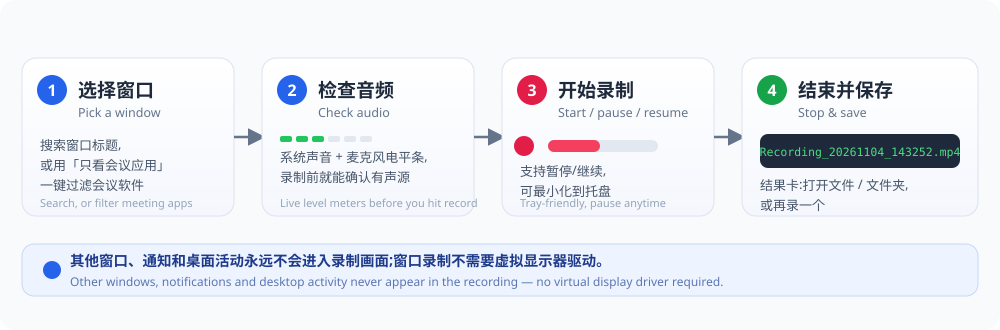
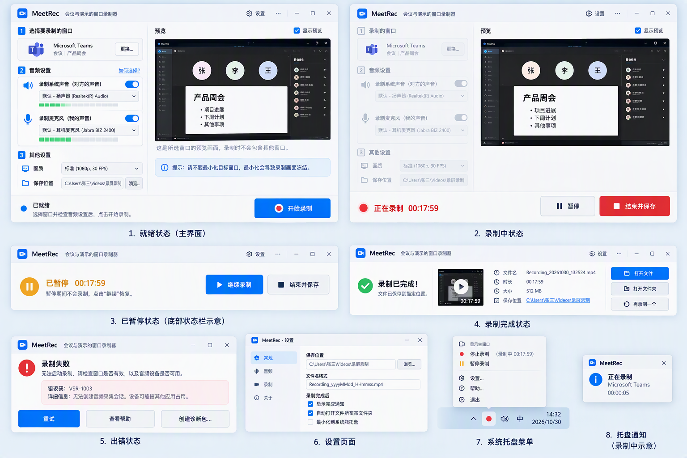
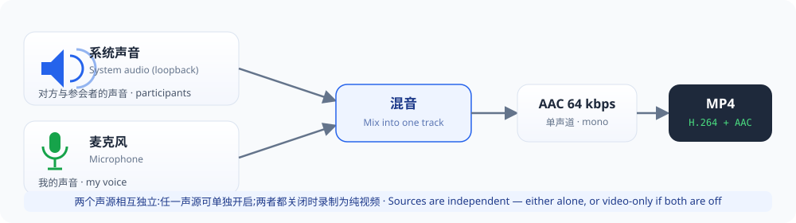

# MeetRec User Manual

> Applies to: MeetRec 1.1 · Windows 10 2004+ x64 / Windows 11 x64
> A step-by-step, illustrated guide to everyday use; this manual will also be published to the
> GitHub Wiki once the repository goes public.

## Contents

1. [What is MeetRec?](#1-what-is-meetrec)
2. [Download and install](#2-download-and-install)
3. [The main window at a glance](#3-the-main-window-at-a-glance)
4. [Step by step: record a meeting](#4-step-by-step-record-a-meeting)
5. [Recording from the tray](#5-recording-from-the-tray)
6. [Settings reference](#6-settings-reference)
7. [Troubleshooting](#7-troubleshooting)
8. [Known limitations](#8-known-limitations)
9. [FAQ](#9-faq)

---

## 1. What is MeetRec?

MeetRec is a **window recorder for meetings and demos**: it records **one** application window
of your choice (a Teams/Zoom/Tencent Meeting call, a slide deck being presented, …), optionally
mixes in system audio (the other participants) and your microphone, and saves a clean
**H.264 MP4**.

- Other windows, notifications and popups **never appear** in the recording — ideal for private
  online meetings and demos.
- Portable, no installer, no admin rights, no driver needed.
- UI available in Simplified Chinese and English.

## 2. Download and install

### 2.1 System requirements

| Item | Requirement |
|---|---|
| OS | Windows 10 2004 (build 19041) or newer **x64**, or Windows 11 x64 |
| CPU | Intel / AMD x64 processor |
| GPU | Direct3D 11 capable GPU with a current vendor driver |
| Rights | **No** administrator rights |
| Dependencies | **No** VC++ runtime (statically linked), **no** separate ffmpeg install (bundled) |

> **There is no 32-bit build.** 32-bit Windows and ARM64 are out of scope.

### 2.2 Download

1. Open the project's [Releases page](https://github.com/ituff/meetrec/releases/latest).
2. Download `MeetRec-<version>-win64-with-ffmpeg.zip` (≈100 MB, ffmpeg included).

### 2.3 Install (extract) and first run

1. Extract the **whole** archive into a writable directory, e.g. `D:\Apps\MeetRec`.
   > ⚠️ Keep the folder intact: `ffmpeg.exe` and its DLLs must stay next to `MeetRec.exe`,
   > or the bundled ffmpeg recording backend cannot be used.
2. Double-click `MeetRec.exe`.
3. On first launch Windows SmartScreen may warn about an unknown publisher (the binary is not
   code-signed yet): click **More info → Run anyway**.
4. MeetRec opens its main window and creates a tray icon (the camera icon near the clock).

### 2.4 Where MeetRec keeps its data

| Content | Location |
|---|---|
| Settings | `%LOCALAPPDATA%\VirtualScreenRecorder\settings.json` |
| Logs | `%LOCALAPPDATA%\VirtualScreenRecorder\Logs\` |
| Diagnostics | `%LOCALAPPDATA%\VirtualScreenRecorder\Diagnostics\` |
| Default output | Your *Videos* folder (changeable in Settings → Recording) |

> Upgrading or moving the app does not lose your configuration — the data folder name is fixed.

## 3. The main window at a glance

| Area | Purpose |
|---|---|
| ① Target window | The selected window card; *Change…* re-opens the picker |
| ② Audio | Independent toggles, device selectors and **live level meters** for system audio (participants) and microphone (your voice) |
| ③ Other settings | Quality (default Standard 1080p / 30 FPS) and save location |
| Preview | Live 10 FPS preview of the target — what you see is what gets recorded; disable with *Show preview* |
| Footer | Status capsule (Ready / Recording / Paused / Finished / Error) + the primary action button |

The remaining states — recording (timer + Pause / Stop & save), paused, the result card, the
error card, the settings window, the tray menu and the recording toast — are shown in the
image above and explained step by step below.

## 4. Step by step: record a meeting

### Step 1: Pick the window

1. Start MeetRec and make sure the meeting/demo window is **open and not minimized**.
2. Click *Select window* to open the picker:
   - Type a keyword of the window title in the search box (e.g. "Weekly sync");
   - or tick **Meeting apps only** to list just meeting software (Teams, Zoom, Tencent
     Meeting, Feishu/Lark, DingTalk, …, Google Meet in a browser);
   - each row shows the app icon and window title — click your target.
3. Back on the main window the target card shows your choice and the preview appears.

> 💡 The recording captures the **whole window** (title bar included). Do not minimize the
> target while recording — Windows may stop redrawing a minimized app and the video freezes
> (the UI shows this hint).

### Step 2: Verify audio (wear headphones)

As soon as a window is selected the level meters go live — **verify before you record**:

1. **System audio (participants)**: toggle on and pick the speaker/headset device (default is
   fine). Ask a participant to say something and watch the green meter.
2. **Microphone (your voice)**: toggle on and pick your microphone; speak and watch the meter.
3. The two sources are **independent**: either alone works, both off records video-only.
4. **Wear headphones**: without them the microphone also picks up your speakers and the
   recording contains an echo of the participants.
5. **Pick the devices the meeting app itself uses**: Teams / Zoom / Tencent Meeting keep their
   own audio device selection which may differ from the Windows default — match them in the two
   selectors, otherwise that source ends up **silent**.

### Step 3: Quality and save location

- **Quality**: the default *Standard (1080p, 30 FPS)* is the recommended choice for meeting
  recordings; 60 FPS buys nothing for slides or talking heads and produces larger files.
  Switch presets only for high-motion demos.
- **Save location**: defaults to a *Screen recordings* folder inside your *Videos* directory;
  click *Browse…* to change it.
- Files are named `Recording_yyyyMMdd_HHmmss.mp4`; name collisions get a numeric suffix and
  never overwrite older recordings.

### Step 4: Start recording

1. Confirm the footer shows **Ready**.
2. Click the blue **Start recording** button. The status moves to *Preparing…*, then
   *Recording*; the buttons become *Pause* and the red *Stop & save*, and the timer starts.
3. While recording, the audio setup controls are temporarily disabled (to avoid accidental
   changes), but the level meters keep moving so you can watch both sources.

### Step 5 (optional): Pause / resume

- Click **Pause**: nothing is recorded while paused and the timer stops; status shows *Paused*.
- Click **Resume recording** to continue.

### Step 6: Stop and save

Click the red **Stop & save** button. The status briefly shows *Saving…* (muxing the MP4),
then the **result card** appears.

### Step 7: Use the result card

The result card shows file name, duration, size and path, with three actions:

- **Open file** — play the finished MP4 in your default player;
- **Open folder** — locate it in File Explorer;
- **Record again** — return to Ready with the same settings for the next session.

## 5. Recording from the tray

- You can minimize MeetRec itself while recording (**this minimizes MeetRec — not the recorded
  meeting window**, which must stay visible).
- Tray menu: Open / Pause-Resume / Stop / Settings / Help / Exit.
- While recording, a **non-activating** toast shows the current target and duration; clicking
  it returns to the main window without stealing focus.

## 6. Settings reference

Open *⚙ Settings* from the main window header. Four pages:

| Page | Options |
|---|---|
| **General** | UI language (system / 简体中文 / English), general behavior |
| **Audio** | Level meter and default device related options |
| **Recording** | Save location, file name format, post-recording actions (show completion notification / auto-open folder / minimize to tray) |
| **About** | Version, author and project links |

## 7. Troubleshooting

### 7.1 The error card

When a recording fails, the main window shows an **error card** with the error code and
explanation plus three actions:

- **Retry** — try again with the current settings;
- **Help** — open the help documentation;
- **Diagnostics** — create a redacted diagnostics package (no recorded content) under
  `Diagnostics\` for support.

### 7.2 Error code reference

| Code | Meaning | What to do |
|---|---|---|
| `VSR-INIT-OS-UNSUPPORTED` | OS too old or not x64 | Move to Windows 10 2004+ x64 / Windows 11 |
| `VSR-INIT-D3D-FAILED` | Direct3D 11 initialization failed | Update the GPU driver; not a Remote Desktop/Sandbox session |
| `VSR-CAPTURE-INIT-FAILED` | Window capture could not start | Target may be closed or protected; pick another window |
| `VSR-CAPTURE-DEVICE-LOST` | GPU device lost mid-recording | Update GPU driver; restart the app and retry |
| `VSR-TARGET-INVALID` / `VSR-TARGET-LOST` | Target window invalid or closed | Select the window again |
| `VSR-ENCODER-UNAVAILABLE` | No usable H.264 encoder | Check GPU driver; run with the bundled ffmpeg |
| `VSR-ENCODER-WRITE-FAILED` / `VSR-FINALIZE-FAILED` | Encoder/mux write error | Check the save location is writable and has space |
| `VSR-OUTPUT-DISK-LOW` | Disk below the free-space guard | Free space on the output drive |
| `VSR-OUTPUT-NOT-WRITABLE` | Output location not writable | Choose a directory you can write to (e.g. D:\) |
| `VSR-DISPLAY-DISCONNECTED` | Virtual display removed mid-recording | Content recorded so far is saved safely; just start again |
| `VSR-INIT-DRIVER-MISSING` / `VSR-DISPLAY-NOT-FOUND` | Virtual display driver unavailable | Window recording needs no driver; driver install is a dev-only scenario |
| `VSR-INTERNAL-STATE` | Unexpected internal state | Create a diagnostics package and report |

### 7.3 Common symptoms

| Symptom | Cause | Fix |
|---|---|---|
| No participants' audio in the file | Meeting app uses a different output device than MeetRec | Set *System audio* to the same device the meeting app uses |
| No microphone in the file | Mic toggle off / wrong device / device exclusive to the meeting app | Enable the mic, select the right device, check Windows mic privacy settings |
| Echo of participants in the file | Speakers played back into the microphone | Wear headphones, or record system audio only |
| Level meters not moving | Source muted or wrong device selected | Confirm the device shows signal in Windows sound settings |
| Video freezes | Target window was minimized | Keep the target in a normal (non-minimized) state |
| Black video | DRM-protected or capture-suppressing target | Expected protection behavior; MeetRec never bypasses it |
| Preview black but recording fine | Some protected windows cannot be previewed | Harmless — trust the recorded file |
| exe does not start / SmartScreen blocks | Unsigned binary notice | *More info → Run anyway*; verify the folder was extracted completely |

## 8. Known limitations

- No HDR / H.265 / AV1 / 4K; output is SDR 8-bit H.264 MP4
- Some Windows builds draw a yellow border around captured content; it may be visible in the
  recording (OS behavior)
- Secure desktops (UAC prompts, lock screen) are never captured
- MeetRec never bypasses DRM or app-side capture suppression
- Full list: [known-limitations.md](known-limitations.md)

## 9. FAQ

**Q: Do I need administrator rights?**
A: No. Portable by design; window recording needs no driver at all.

**Q: Does it conflict with the meeting app's cloud recording?**
A: No. MeetRec records locally and independently; cloud recording keeps working alongside.

**Q: How large is a 25-minute 1080p meeting?**
A: In the same range as a Teams cloud recording (tens of MB): x264 capped-CRF spends almost no
bits on static slides while keeping text sharp.

**Q: Can I record the whole screen instead?**
A: MeetRec focuses on recording exactly one window — nothing outside it (including other
monitors) is captured.

**Q: Will an upgrade lose my settings?**
A: No. Settings live in `%LOCALAPPDATA%\VirtualScreenRecorder\`, independent of the app folder.

**Q: Is English available?**
A: Yes — the UI defaults to the Windows display language; force it in
Settings → General → Language (简体中文 / English).

---

*MeetRec User Manual · When reporting an issue, please attach the diagnostics package created
via *Diagnostics* (it contains no recorded content).*
