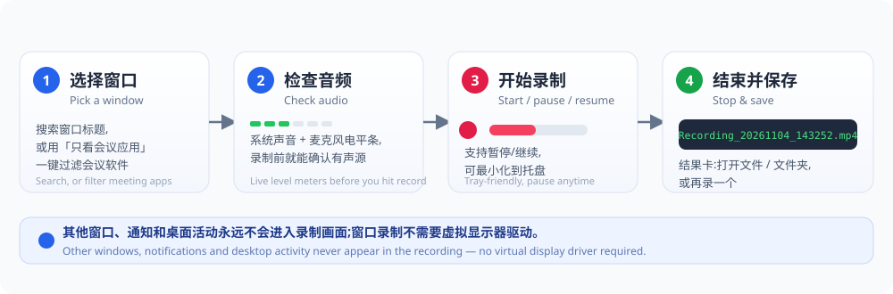
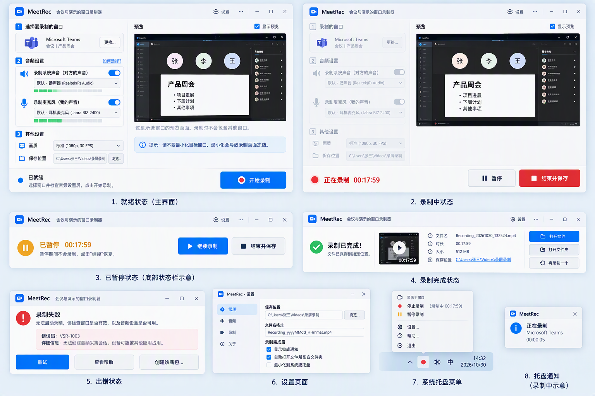
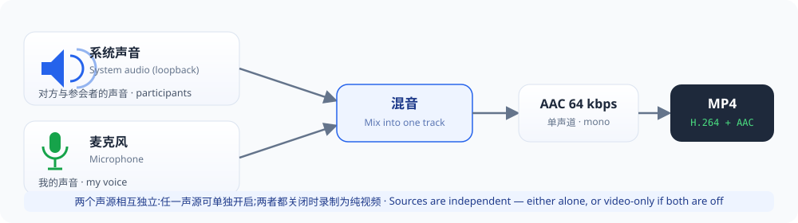

# MeetRec 使用手册

> 适用版本:MeetRec 1.2 · Windows 10 2004+ x64 / Windows 11 x64
> 本手册图文并茂、分步讲解日常使用;仓库公开后将同步发布到 GitHub Wiki。

## 目录

1. [MeetRec 是什么](#1-meetrec-是什么)
2. [下载与安装](#2-下载与安装)
3. [认识主界面](#3-认识主界面)
4. [一步步:录制一场会议](#4-一步步录制一场会议)
5. [最小化到托盘录制](#5-最小化到托盘录制)
6. [压缩旧录屏](#6-压缩旧录屏)
7. [设置页详解](#7-设置页详解)
8. [遇到问题](#8-遇到问题)
9. [已知限制](#9-已知限制)
10. [常见问答 FAQ](#10-常见问答-faq)

---

## 1. MeetRec 是什么

MeetRec 是一款**会议与演示的窗口录制器**:只录制你选定的**一个**应用窗口(例如 Teams、
Zoom、腾讯会议或正在演示的 PPT),可选混入系统声音(对方/参会者)与麦克风(你的声音),
输出干净的 **H.264 MP4** 文件。

- 其他窗口、通知、弹窗**不会入镜**,适合录制需要保护隐私的在线会议与演示
- 免安装、免管理员、无需驱动,解压即用
- 界面支持简体中文与英文

## 2. 下载与安装

### 2.1 系统要求

| 项目 | 要求 |
|---|---|
| 操作系统 | Windows 10 2004(build 19041)及以上 **x64**,或 Windows 11 x64 |
| 处理器 | Intel / AMD x64 处理器 |
| 显卡 | 支持 Direct3D 11 的显卡(驱动保持更新) |
| 权限 | **不需要**管理员权限 |
| 依赖 | **不需要** VC++ 运行库(已静态链接)、**不需要**单独安装 ffmpeg(已内置) |

> **没有 32 位版本。** Windows 10 的 32 位版本和 ARM64 均不在支持范围。

### 2.2 下载

1. 打开项目的 [Releases 页面](https://github.com/ituff/meetrec/releases/latest)。
2. 下载 `MeetRec-<版本>-win64-with-ffmpeg.zip`(约 100 MB,已内置 ffmpeg)。

### 2.3 安装(解压)与首次运行

1. 将压缩包**整个**解压到一个可写目录,例如 `D:\Apps\MeetRec`。
   > ⚠️ 请保持文件夹完整:`ffmpeg.exe` 及其 DLL 必须与 `MeetRec.exe` 在同一目录,
   > 只复制 exe 会导致无法使用内置的 ffmpeg 录制后端。
2. 双击 `MeetRec.exe` 运行。
3. 首次运行时,Windows SmartScreen 可能提示"未知发布者"(程序尚未做代码签名):
   点击 **更多信息 → 仍要运行**。
4. 程序启动后出现在主界面 + 系统托盘(时钟附近的摄像头图标)。

### 2.4 数据存放位置

| 内容 | 位置 |
|---|---|
| 设置文件 | `%LOCALAPPDATA%\VirtualScreenRecorder\settings.json` |
| 日志 | `%LOCALAPPDATA%\VirtualScreenRecorder\Logs\` |
| 诊断包 | `%LOCALAPPDATA%\VirtualScreenRecorder\Diagnostics\` |
| 默认录制目录 | 你的"视频"目录(可在设置页修改) |

> 升级/重装不会丢失配置:设置与日志目录名固定,与程序位置无关。

## 3. 认识主界面

| 区域 | 说明 |
|---|---|
| ① 选择要录制的窗口 | 显示当前目标窗口卡片;点击「更换…」重新选择 |
| ② 音频设置 | 系统声音(对方)与麦克风(我的声音)两组独立开关、设备选择器与**实时电平条** |
| ③ 其他设置 | 画质(默认标准 1080p/30FPS)与保存位置 |
| 预览区 | 所选窗口的实时预览(10 FPS),录制内容就是预览内容;可勾选「显示预览」关闭 |
| 底部状态栏 | 状态胶囊(已就绪 / 正在录制 / 已暂停 / 已完成 / 出错)+ 主操作按钮 |

界面上其余状态:录制中(计时 + 暂停/结束并保存)、已暂停、录制完成结果卡、出错错误卡、
设置窗口、托盘菜单、录制通知卡片,见上文配图与后文逐步说明。

## 4. 一步步:录制一场会议

### 第 1 步:选择要录制的窗口

1. 启动 MeetRec,确保会议/演示窗口**已打开且未最小化**。
2. 点击「选择窗口」,打开窗口选择器:
   - 在搜索框输入窗口标题关键字(如"产品周会");
   - 或勾选 **「只看会议应用」**,列表只显示 Teams、Zoom、腾讯会议、飞书、钉钉等
     会议软件(含浏览器中的 Google Meet);
   - 每一项显示应用图标与窗口标题,点选目标后确认。
3. 回到主界面,目标卡片显示所选窗口,预览区出现该窗口画面。

> 💡 提示:录制的是**整个窗口**(含标题栏)。请勿最小化目标窗口——Windows 可能停止重绘
> 最小化的应用,导致录制画面冻结(界面内也会提示)。

### 第 2 步:确认声音(推荐戴耳机)

选中窗口后,电平条立即开始工作——**先确认、再录制**:

1. **系统声音(对方的声音)**:开启后选择扬声器/耳机设备(默认即可);
   让会议里的对方说句话,观察绿色电平条跳动。
2. **麦克风(我的声音)**:开启后选择你的麦克风设备;
   对着说话观察电平条。
3. 两个声源**相互独立**:只开一个也行,都关闭则录制纯视频。
4. **戴耳机**:外放会让麦克风同时录到对方声音,产生回声。
5. **选择会议软件正在使用的设备**:Teams / Zoom / 腾讯会议都有自己的音频设备选择,可能与
   Windows 默认设备不同;请在 MeetRec 的两个设备选择器中选与会议软件一致的设备,
   否则对应声源会是**无声**的。

### 第 3 步:画质与保存位置

- **画质**:默认「标准(1080p, 30 FPS)」即录制会议的推荐值;幻灯片与人像 60 FPS 没有
  收益,文件反而更大。如需录制高帧率演示可切换其他预设。
- **保存位置**:默认为你的"视频"目录下的"屏幕录制"文件夹;点击「浏览…」可更改。
- 文件名格式为 `Recording_年月日_时分秒.mp4`,重名自动追加序号,不会覆盖旧文件。

### 第 4 步:开始录制

1. 确认状态栏为「已就绪」。
2. 点击蓝色 **「开始录制」** 按钮。状态变为「准备中…」,随后进入「正在录制」,
   按钮区变为「暂停」与红色「结束并保存」,并开始计时。
3. 录制期间音频设置控件会临时禁用(防止误改),但电平条仍在跳动,可随时确认两个声源。

### 第 5 步(可选):暂停 / 继续

- 点击「暂停」:暂停期间不录制内容,计时也暂停;状态为「已暂停」。
- 点击「继续录制」恢复。

### 第 6 步:结束并保存

点击红色 **「结束并保存」**。状态短暂显示「正在保存…」(写入并封装 MP4),
随后弹出**结果卡**。

### 第 7 步:在结果卡中打开

结果卡显示文件名、时长、大小与保存路径,并提供三个操作:

- **打开文件**:用系统播放器播放刚录好的 MP4;
- **打开文件夹**:在资源管理器中定位该文件;
- **再录一个**:回到就绪状态,用同样的设置再录一场。

## 5. 最小化到托盘录制

- 录制期间可直接最小化 MeetRec 本体(**注意:最小化的是 MeetRec,不是被录制的会议窗口**)。
- 托盘图标菜单:打开 / 暂停-继续 / 停止 / 设置 / 帮助 / 退出。
- 录制中出现一张**不打断输入焦点**的桌面通知卡片,显示当前目标与时长;点击可回到主界面。

## 6. 压缩旧录屏

除了录制新会议,MeetRec 还能把**以前用其他软件录下的视频**重新压小——编码配方与录制一致,
输出同样是 H.264 MP4。

### 6.1 打开压缩窗口

主界面右上角「⋯ 更多」→「压缩视频...」,或在托盘菜单选择「压缩视频...」。压缩窗口与录制
窗口相互独立,可以边等压缩边准备下一场会议。

### 6.2 添加文件

- 点击「添加视频...」选择一个或多个文件,或直接把文件拖进窗口;
- 支持 MP4 / MKV / MOV / AVI / WMV / FLV / TS / WebM 等常见格式;
- 添加后自动读取时长、分辨率、大小和编码;读取失败仍可尝试压缩。

### 6.3 选择画质与分辨率

| 画质 | 适用场景 | 特点 |
|---|---|---|
| 流畅 | 文件越小越好、以文字/幻灯片为主 | 更低码率上限,文件最小 |
| 标准 | 会议录制(推荐) | capped CRF + 屏幕内容优化 |
| 高清 | 动态画面较多/演示视频 | 更高码率,保留更多细节 |

「分辨率」默认保持原分辨率;选 720p / 1080p 会在保持宽高比的前提下降分辨率,文件通常
明显更小,但文字会变软。

### 6.4 输出位置与预计体积

- 默认输出到与源文件相同的文件夹,文件名形如 `会议-min.mp4`;
- 点击「更改...」可以统一输出到另一个文件夹;
- 名称冲突时自动追加 `-2`、`-3`,**永远不会覆盖源文件或已有文件**;
- 窗口下方显示预计输出体积上限;源文件码率已经很低时会提示压缩收益可能有限。

### 6.5 开始压缩

点击「开始压缩」后队列逐个处理:

- 每行显示进度与速度,底部显示当前第几个文件和预计剩余时间;
- 「取消当前任务」停止当前文件并把它放回队列,再点「开始压缩」可继续;
- 完成后点「打开文件」播放结果,或双击该行;
- **录制进行中时压缩会自动暂停**,录制结束后自动继续,避免和录制抢 CPU。

### 6.6 备注

- 压缩是重新编码(有损),对已经压得很小的文件收益有限;
- 压缩失败会显示原因,源文件不受影响;
- 需要 `ffprobe.exe` 与 `MeetRec.exe` 在同一目录(发布包已内置)。

## 7. 设置页详解

主界面右上角「⚙ 设置」打开设置窗口,共四页:

| 页面 | 可配置项 |
|---|---|
| **常规** | 界面语言(跟随系统 / 简体中文 / English)、自动检查更新、托盘行为等 |
| **音频** | 电平条与默认设备相关选项 |
| **录制** | 保存位置、文件名格式、录制完成后动作(显示完成通知 / 自动打开文件所在文件夹 / 最小化到系统托盘) |
| **关于** | 版本信息、作者与项目链接 |

发现新版本时,菜单「更多」会出现检查更新提示;点击后可以下载并安装,或打开发布页手动下载。
安装会退出 MeetRec、替换便携版文件并自动重启。自动检查每个自然日最多一次。

## 8. 遇到问题

### 8.1 错误卡与重试

录制失败时主界面显示**错误卡**:错误码、详细信息,以及三个操作:

- **重试**:按当前设置重新尝试;
- **查看帮助**:跳转帮助文档;
- **创建诊断包**:在 `Diagnostics\` 目录生成脱敏的诊断信息(不含录像内容),便于反馈问题。

### 8.2 错误码速查

| 错误码 | 含义 | 建议处理 |
|---|---|---|
| `VSR-INIT-OS-UNSUPPORTED` | 系统版本过旧或非 x64 | 升级到 Windows 10 2004+ x64 / Windows 11 |
| `VSR-INIT-D3D-FAILED` | Direct3D 11 初始化失败 | 更新显卡驱动;确认非远程桌面/沙盒环境 |
| `VSR-CAPTURE-INIT-FAILED` | 无法启动窗口捕获 | 目标窗口可能已关闭或受保护;更换窗口重试 |
| `VSR-CAPTURE-DEVICE-LOST` | 显卡设备中途丢失 | 更新显卡驱动;重启应用后重试 |
| `VSR-TARGET-INVALID` / `VSR-TARGET-LOST` | 目标窗口无效或已关闭 | 重新选择窗口 |
| `VSR-ENCODER-UNAVAILABLE` | 没有可用的 H.264 编码器 | 确认显卡驱动正常;或携带内置 ffmpeg 运行 |
| `VSR-ENCODER-WRITE-FAILED` / `VSR-FINALIZE-FAILED` | 编码/封装写入失败 | 检查保存位置可写、磁盘空间 |
| `VSR-TRANSCODE-FAILED` | 压缩失败(源文件无法读取或 ffmpeg 失败) | 确认源文件能正常播放;创建诊断包并反馈 |
| `VSR-OUTPUT-DISK-LOW` | 磁盘空间不足 | 清理保存位置所在磁盘 |
| `VSR-OUTPUT-NOT-WRITABLE` | 保存位置不可写 | 更换到有写权限的目录(如 D:\) |
| `VSR-DISPLAY-DISCONNECTED` | 虚拟显示器中途断开(仅虚拟显示器路径) | 已安全保存此前内容;重新开始即可 |
| `VSR-INIT-DRIVER-MISSING` / `VSR-DISPLAY-NOT-FOUND` | 虚拟显示器驱动不可用(仅虚拟显示器路径) | 窗口录制无需驱动;仅开发场景需要安装 |
| `VSR-INTERNAL-STATE` | 内部状态异常 | 创建诊断包并反馈 |

### 8.3 常见问题排查表

| 现象 | 原因 | 处理 |
|---|---|---|
| 录像没有对方声音 | 会议软件用的扬声器与 MeetRec 选的不一致 | 在「系统声音」设备选择器中选与会议软件相同的输出设备 |
| 录像没有我的声音 | 麦克风未开启/选错设备/被会议软件独占 | 开启麦克风并选择正确设备;检查 Windows 麦克风隐私设置 |
| 我的 声音+对方声音有回声 | 没戴耳机,麦克风录到了外放 | 戴耳机;或暂时只录系统声音 |
| 电平条不动 | 声源静音或设备选错 | 在 Windows 声音设置中确认该设备有信号 |
| 画面冻结 | 目标窗口被最小化 | 保持目标窗口正常显示(非最小化) |
| 画面黑屏 | 目标是 DRM 保护或禁止捕获的窗口/内容 | 属正常保护行为,产品不绕过捕获限制 |
| 预览黑屏但录制正常 | 个别受保护窗口无法预览 | 不影响录制,以结果文件为准 |
| 双击 exe 无反应 / SmartScreen 拦截 | 未签名提示 | 「更多信息 → 仍要运行」;确认解压完整 |

## 9. 已知限制

- 无 HDR / H.265 / AV1 / 4K;输出为 SDR 8-bit H.264 MP4
- 部分 Windows 版本会在捕获画面周围绘制黄色边框,可能出现在录像中(系统行为)
- UAC 提示、锁屏等安全桌面永远不会被捕获
- 不绕过任何 DRM 或应用的反捕获机制
- 支持边界详见 [known-limitations.md](known-limitations.md)

## 10. 常见问答 FAQ

**Q:需要管理员权限吗?**
A:不需要。便携解压即用;录制窗口也不需要任何驱动。

**Q:和会议软件自带的云录制冲突吗?**
A:不冲突。MeetRec 在本地独立录制,云录制照常使用;两者互不影响。

**Q:录制 25 分钟的 1080p 会议文件多大?**
A:标准画质下与 Teams 云录制同一量级(约几十 MB):x264 capped-CRF 让静态幻灯片几乎不耗
码率,文字保持清晰。

**Q:能同时录整个屏幕吗?**
A:MeetRec 专注"只录一个窗口";窗口之外的内容(包括其他显示器)不会入镜。

**Q:升级版本会丢设置吗?**
A:不会。设置保存在 `%LOCALAPPDATA%\VirtualScreenRecorder\`,与程序目录无关。

**Q:支持中文界面吗?**
A:支持,默认跟随 Windows 显示语言;可在 设置 → 常规 → 语言 中强制 简体中文 / English。

---

*MeetRec 使用手册 · 如需反馈问题,请附上「创建诊断包」生成的诊断文件(不含录像内容)。*
